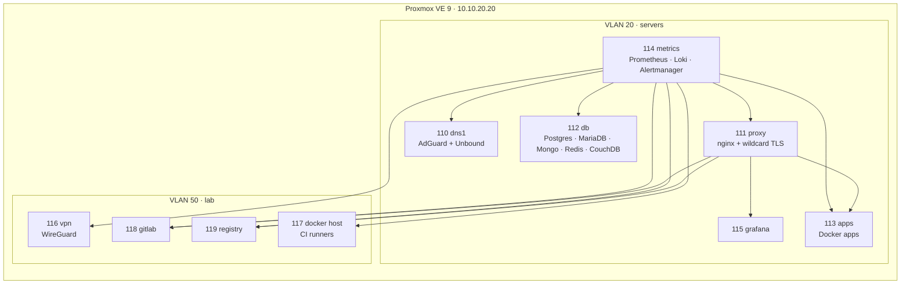

# proxmox

My homelab as code: one Proxmox VE host running ten unprivileged Debian 13 LXC containers for DNS, reverse proxy, databases, monitoring, VPN, GitLab and a Docker registry.

- **Terraform** describes the containers (adopted with `import` blocks, never recreated).
- **Ansible** configures what runs inside them, reaching each container through `pct` on the host, so no SSH keys live in the containers.
- **Secrets** come from a private repo encrypted with SOPS + age; nothing secret is stored here.



## Layout

| Path | What |
|---|---|
| [`terraform/`](terraform) | Containers (`bpg/proxmox`), state kept in the lab GitLab |
| [`ansible/`](ansible) | One role per service, one playbook per container, `site.yml` for everything |
| [`scripts/`](scripts) | Operational scripts: certificates, DNS metrics, monitoring checks, WireGuard peers, CouchDB |
| [`docs/`](docs) | How it all fits together: network, DNS, proxy and certificates, databases, monitoring, runbooks, known traps |

## Use

Needs `terraform`, `ansible`, `sops` and `age`, the age key for the secrets repo, and SSH to the Proxmox host as root.

```bash
git clone git@github.com:ahmedbaig/proxmox.git
git clone git@github.com:ahmedbaig/homelab-secrets.git   # private; or set HOMELAB_SECRETS

./scripts/bootstrap-terraform-secrets.sh   # once: Proxmox API token + GitLab state token

cd terraform && ./tf.sh plan               # should report no changes against the live host

cd ../ansible
ansible-playbook playbooks/site.yml --check --diff
ansible-playbook playbooks/proxy.yml
```

Everything is checked against the running lab before it is committed: `terraform plan` shows no changes and every playbook runs in `--check` mode with nothing to change.

## Not in here

The Docker host on CT 117 runs a private work test stack; only its generic host setup (Docker, egress policy, GitLab runner install) is public.
