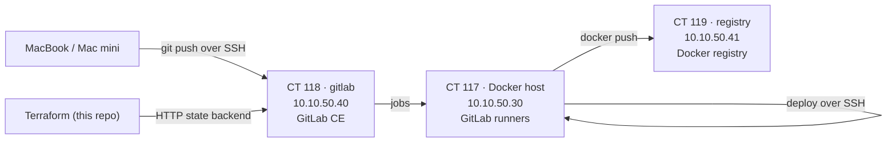

# CI and Registry

A self-hosted build pipeline on the Lab VLAN (`10.10.50.0/24`). None of it is
exposed to the internet; it is reached through the reverse proxy on the LAN or
over WireGuard.

| | CT 118 `gitlab` | CT 119 `registry` |
|---|---|---|
| Address | `10.10.50.40` · `gitlab.lab.baig.network` | `10.10.50.41` · `registry.lab.baig.network` |
| Through the proxy | `https://gitlab.baig.network` | `https://registry.baig.network`, UI at `registry-ui.baig.network` |
| Software | GitLab CE (omnibus), tuned for one user: Puma single mode, low Sidekiq concurrency, bundled Prometheus off, built-in registry off | Debian `docker-registry`, systemd, weekly garbage-collect timer |
| TLS | the wildcard certificate, distributed from CT 111 | same |
| Outbound | locked to the lab | locked to the lab |

## GitLab CE — CT 118

- SSH clones go straight to port 22 on `gitlab.lab.baig.network`; HTTPS goes
  through the proxy.
- The first root password is in `/etc/gitlab/initial_root_password`, which
  GitLab **deletes 24 h after install** — change it at first login.
- Puma in single mode **can stall for about a minute under load**. Scripts that
  drive the API should retry.

## Docker registry — CT 119

- htpasswd authentication, a single user for pushes and pulls.
- `registry-gc.timer` runs `docker-registry garbage-collect --delete-untagged`
  weekly. It stops the registry for the duration, so pushes and pulls fail for
  about a minute.
- Garbage collection only removes **untagged** blobs. Tagged images accumulate
  until their tags are deleted.

## Runners — CT 117

CT 117 is a Docker host running a private work test stack. It carries two
runners: a Docker executor for test jobs (tag `docker`) and a shell executor
for untagged package and deploy jobs. Builds run one at a time
(`concurrent = 1`) because memory, not CPU, is the limit on this host.

> [!WARNING]
> **CI builds fill the disk fast.** Base images, per-job layers and build cache
> reached 24 GB in a few hours. Prune unused images after builds and `pct fstrim`
> the container so the thin pool gets the space back.

## Terraform state

The Terraform in this repo keeps its state in GitLab's built-in Terraform state
store (project `home-lab/proxmox`), through the `http` backend. State never
lands in git, and GitLab provides the locking.

Related: [Proxmox and Containers](proxmox-and-containers.md) · [Host Lifecycle](host-lifecycle.md) · [Firewall Policies](firewall-policies.md)
