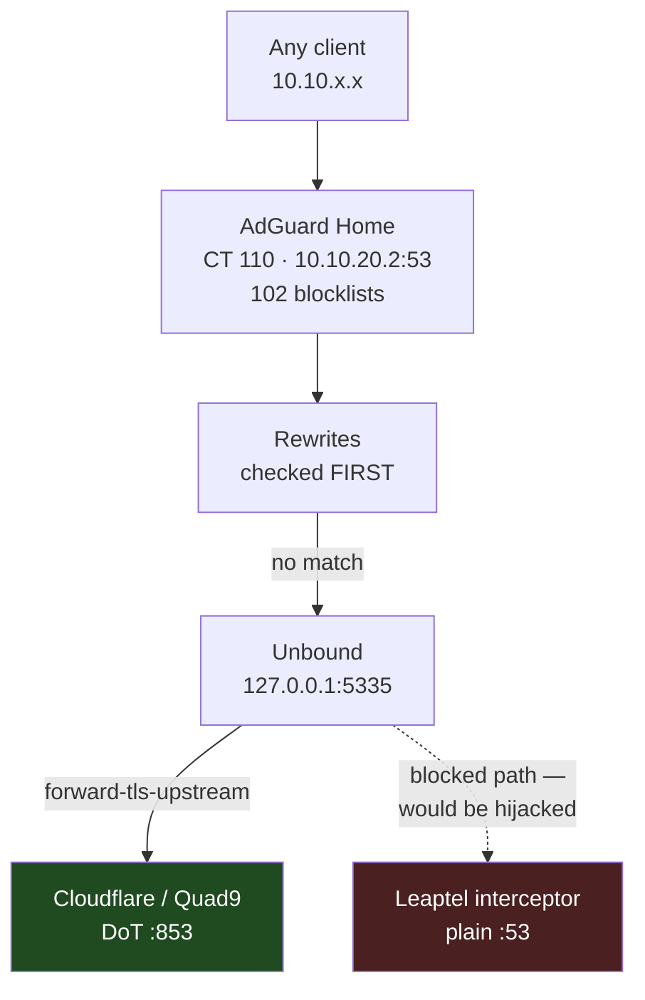
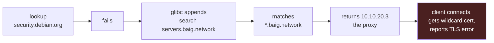

# DNS

## Shape



dns1 is **CT 110**: AdGuard Home on port 80 for the UI, Unbound bound to
`127.0.0.1:5335`. It has 8 GB of RAM — 102 blocklists with duplicate formats is
what eats it.

- UI: https://dns1.baig.network (user `ahmed`)
- Reverse lookups go to the UX7 via `local_ptr_upstreams: [10.10.20.1]`
- Fallbacks are `tls://1.1.1.1`, `tls://1.0.0.1`, `tls://dns.quad9.net`

## Your ISP intercepts all port 53 traffic

This is the single most important thing on this page.

**Every DNS query leaving this network on port 53 is answered by Leaptel, not by
the server you addressed.** It is destination-agnostic — addresses that cannot
exist on the internet still "answer":

```
dig @192.0.2.1   example.com     → 104.20.23.154     (TEST-NET-1, unroutable)
dig @203.0.113.9 google.com      → 142.250.195.238   (TEST-NET-3, unroutable)
dig @240.0.0.1   cloudflare.com  → 104.16.132.229    (reserved Class E)
```

A root server query gives it away too. Ask `198.41.0.4` for
`security.debian.org` and you get `flags: qr rd ra` with `ANSWER: 4`. Real root
servers answer `qr aa` with a delegation and **zero** answers, and never offer
recursion.

### How it was located

```
port 53  → 198.41.0.4 :  hop 1  10.10.20.1 (0.48ms)   hop 2  "198.41.0.4" (4.2ms)  ← answered here
port 853 → 1.1.1.1    :  hop 1  10.10.20.1 (0.67ms)   hop 2  192.168.4.1 (1.6ms)
                         hop 3  172.31.0.22 (4.2ms)   … hop 8  1.1.1.1
```

Hop 1 is the UX7 and it passes traffic through — if UniFi were intercepting,
the answer would come back at 0.5 ms from hop 1. The responder sits at ~4.2 ms,
matching Leaptel's core one hop past their CGNAT at `192.168.4.1`.

**It is not UniFi Content Filtering** (which genuinely caused a separate
outage before — see [Known Traps](known-traps.md)) and **not the Mac mini** (nothing listens
on port 53 there; dns2 is decommissioned).

### What it broke, and how it presented

Unbound cannot walk the delegation chain from the root when every hop is
answered by an interceptor. Names the interceptor happened to resolve worked;
the rest returned SERVFAIL, and DNSSEC failed wherever the substituted answers
carried no valid signatures. Four names were confirmed broken:

| Name | Symptom | Why it mattered |
|---|---|---|
| `production.cloudfront.docker.com` | NXDOMAIN | no Docker image pulls |
| `apache.jfrog.io` | DNSSEC SERVFAIL | no CouchDB install |
| `couchdb.apache.org` | SERVFAIL even with `+cd` | no repo key |
| `security.debian.org` | SERVFAIL | **no apt security updates** |

Each one surfaced as a **TLS certificate error against the proxy**, not as a
DNS failure — see the search-domain trap below.

### The fix

Unbound forwards over DoT on port 853, which is not intercepted:

```
# /etc/unbound/unbound.conf.d/adguard.conf
server:
    tls-cert-bundle: /etc/ssl/certs/ca-certificates.crt

forward-zone:
    name: "."
    forward-tls-upstream: yes
    forward-addr: 1.1.1.1@853#cloudflare-dns.com
    forward-addr: 1.0.0.1@853#cloudflare-dns.com
    forward-addr: 9.9.9.9@853#dns.quad9.net
    forward-addr: 149.112.112.112@853#dns.quad9.net
```

DNSSEC validation still works — `cloudflare.com` returns the `ad` flag and
`dnssec-failed.org` is still correctly rejected.

> [!NOTE]
> **This is permanent, not a workaround**
> dns1 is no longer a recursive resolver; it is a **validating forwarder**. Do
> not revert the `forward-zone` block to "restore recursion" — recursion
> through an interceptor was never recursion. The previous config is kept as
> `adguard.conf.bak-20260926-2330`.

> [!CAUTION]
> **Consequence for the DNS2 plan**
> The old plan was to set DNS2 to `10.10.20.1` on every network so a dns1
> reboot would not take out name resolution. Given the interception, that
> silently routes the whole house through Leaptel on any dns1 blip, with no
> signal that it happened. A second resolver container is the better answer.

Leaptel may disable interception on request. Worth an email; DoT means you are
not blocked either way.

### Proving the upstream leg is actually encrypted

Unbound has **no counter** that says its outbound queries went over TLS.
`num.query.tls` counts queries that *arrived* over TLS — Unbound as a DoT server —
which is a different thing entirely and easy to misread as confirmation.

What there is instead is sockets. `unbound_upstream_connections` counts
established connections to port 853 straight from the kernel, per resolver:

```bash
ssh root@10.10.20.20 'pct exec 110 -- ss -tnH state established | grep ":853"'
```

That matters more here than it would elsewhere. If DoT ever failed and Unbound
fell back to plain port 53, the interceptor would answer and **everything would
keep working** — names would resolve, nothing would alert, and the protection
would be gone. A socket count is the only direct evidence.

Set `extended-statistics: yes`, or `unbound-control stats` reports 55 counters
with no query types, no rcodes and no TLS figures at all. With it, 147.

### Nothing leaves unencrypted — and why it briefly looked like it did

AdGuard's upstreams, in full:

```yaml
upstream_dns:
  - 127.0.0.1:5335                          # Unbound, everything general
  - '[/home.baig.network/]10.10.10.1'       # domain-scoped to one VLAN each
  - '[/servers.baig.network/]10.10.20.1'
  - '[/iot.baig.network/]10.10.30.1'
  - '[/lab.baig.network/]10.10.50.1'
fallback_dns:                               # only when the primary fails
  - tls://1.1.1.1
  - tls://1.0.0.1
  - tls://dns.quad9.net
local_ptr_upstreams: [10.10.20.1]           # reverse DNS for local clients
use_private_ptr_resolvers: true
upstream_mode: load_balance
```

| Upstream | Share of 24h | Leaves the network? |
|---|---|---|
| `127.0.0.1:5335` → Unbound | ~34,000 | yes, **encrypted** (DoT :853) |
| `10.10.20.1:53` gateway | ~6,500 | **no** — internal names and local PTR only |
| `tls://dns.quad9.net` | ~3 | yes, **encrypted** — fallback |

So `dns_queries_leaving_unencrypted` is **0**, and about **81%** of all queries never
leave the house at all (AdGuard's cache, blocks, and internal lookups).

> [!WARNING]
> **This was reported as a 5,500/day plain-port-53 leak, and that was wrong**
> `top_upstreams_responses` reports an upstream as AdGuard *resolved* it, so a
> domain-scoped entry like `[/servers.baig.network/]10.10.20.1` arrives as plain
> `10.10.20.1:53` with nothing to indicate it only ever handles internal names. The
> collector assumed "not loopback ⇒ internet egress" and filed both the gateway
> upstreams and the `tls://` fallback as unencrypted egress.
>
> **Do not remove the gateway upstreams.** They resolve the per-VLAN domains and,
> via `local_ptr_upstreams`, the reverse lookups that put real hostnames on the flow
> map. Removing them would break internal name resolution to fix a leak that does
> not exist.
>
> Upstreams are now classified by address and scheme — loopback, private, `tls://`,
> or public-and-plain — which is the only way to answer "did this leave, and was it
> encrypted?" from the stats AdGuard gives you.

### `1.1.1.1` is ten times slower than the alternatives

From Unbound's own infrastructure cache (`unbound-control dump_infra`), smoothed
RTT per resolver:

| Resolver | RTT |
|---|---|
| `1.0.0.1` cloudflare | 50 ms |
| `9.9.9.9` quad9 | 52 ms |
| `149.112.112.112` quad9 | 70 ms |
| `1.1.1.1` cloudflare | **481 ms** |

Unbound already prefers the faster ones — that is what the infra cache is for — so
this needs no action. Worth knowing before blaming DNS for something.

## The rewrite precedence trap

AdGuard evaluates **rewrites before upstreams**, and `*.baig.network` matches at
*any* depth, not just one label. A wildcard rewrite therefore swallows every
name under the domain, and per-subdomain upstreams like
`[/main.baig.network/]` never run. Exact rewrites do beat the wildcard.

This once cost an hour: `netgear.main.baig.network` kept returning the gateway
because of a `*.main.baig.network → 10.10.20.1` rewrite, then returned the
proxy because of `*.baig.network`. Fix was to delete the `main` entries and let
exact host rewrites do the work.

## Our own allow and block lists

Hand-written rules live in git, not in AdGuard's **Custom filtering rules** box,
which is kept empty. A block only belongs here if no subscribed list already
blocks the name; `check_host` it first. (78 of the original 115 were redundant.)

| File | Rules | Subscribed as |
|---|---|---|
| `ansible/roles/dns/templates/adguard-lists/baig-allow.txt.j2` | `@@` exceptions; work and personal rules come from `dns_adguard_work_allow` / `dns_adguard_personal_allow` in `homelab-secrets/ansible/dns.sops.yaml` | normal filter **baig allow** |
| `ansible/roles/dns/templates/adguard-lists/baig-block.txt.j2` | blocks the subscribed lists miss | normal filter **baig block** |

The dns role renders them to `/opt/AdGuardHome/data/userfilters/` (the only path
`filtering.safe_fs_patterns` allows) and calls `/control/filtering/refresh`. To
change a rule: edit the file, then `ansible-playbook playbooks/dns1.yml`.

> [!IMPORTANT]
> **Both are normal filters, not AdGuard "allowlists".** An allowlist
> (`whitelist_filters`) is checked before the whole block engine, so it beats
> even `$important` blocks. As a normal filter, `baig-allow.txt` follows the usual
> precedence and the `$important` blocks in `baig-block.txt` can carve exceptions
> out of it.

`$important` on a block means "this wins over an allow rule". Without it, these
13 blocks did nothing for months:

- **Apple and Xiaomi telemetry:** overridden by our own `@@||apple.com^` and
  `@@||xiaomi.com^`.
- **`ad.doubleclick.net` and `adservice.google.com`:** overridden by
  `@@||ad.doubleclick.net^` and `@@||adservice.google.*^` in *HaGeZi's
  Allowlist Referral*.

> [!NOTE]
> A refresh re-downloads every list and rebuilds the whole engine. That takes
> about 4 minutes, and AdGuard peaks near the CT's 8 GB while it runs. The old
> rules keep answering until the rebuild finishes. Use `check_host` (below) to
> see when the new ones are live.

## `$important` breaks an allowlist rule

A blocklist was returning `0.0.0.0` for `ahmedpi.ddns.net` — matched by
`||ddns.net^` from *Malware List — AdGuard BETA*, which blocks the whole No-IP
domain rather than that host.

The allowlist rule to override it is:

```
@@||ahmedpi.ddns.net^
```

Written as `@@||ahmedpi.ddns.net^$important` it **does not work** — the name stays
blocked. `$important` raises a rule above the usual precedence order, which is
what you want on a *block* rule, and on an allowlist rule it fights the `@@`
instead of reinforcing it. Adding the modifier felt like belt-and-braces and was
the entire bug.

> [!TIP]
> **Test the filter engine, not the cache**
> `dig` goes through AdGuard's DNS cache, so a fixed rule can look like it is
> still failing for as long as the TTL. `check_host` asks the filtering engine
> directly and answers instantly:
>
> ```bash
> curl -s -u "ahmed:$ADGUARD_PASSWORD" \
>   'http://10.10.20.2/control/filtering/check_host?name=ahmedpi.ddns.net'
> ```
>
> `{"reason":"NotFilteredWhiteList"}` means the allowlist rule is working.
> `{"reason":"FilteredBlackList","rule":"||ddns.net^"}` names the exact rule and
> the filter list id, which beats guessing which blocklist is responsible.

## The search-domain trap

This one is worse, because it turns a clean failure into a confident wrong
answer.



You see `SSL: no alternative certificate subject name matches target hostname`
and go hunting for a certificate problem. There is no certificate problem. The
name simply did not resolve.

Two contributing faults, both fixed:

1. The Proxmox node's search domain was `servers,baig.network` — **a comma
   instead of a dot**. Proxmox split it into two search domains, `servers` and
   `baig.network`, so *every* failed lookup got `.baig.network` appended and hit
   the wildcard. Now `servers.baig.network`.
2. Server containers now have **no search domain at all**. Hosts use FQDNs.

> [!WARNING]
> **Do not set `--searchdomain ""` to clear it**
> That leaves a bare `search` line in `/etc/resolv.conf`, which BIND's parser
> rejects outright — `dig: parse of /etc/resolv.conf failed` — while glibc
> tolerates it. Use `pct set <id> --delete searchdomain`, then remove the stale
> line from `/etc/resolv.conf` (it is only regenerated at boot).

## Current rewrites

```
*.baig.network                  10.10.20.3     ← catch-all → proxy
proxy.servers.baig.network      10.10.20.3
dns1.servers.baig.network       10.10.20.2
macmini.servers.baig.network    10.10.20.10
pve.servers.baig.network        10.10.20.20
win11.servers.baig.network      10.10.20.21    ← VM destroyed 28 Sep, kept for a rebuild
db.servers.baig.network         10.10.20.4
macbook.home.baig.network       10.10.10.10
ml.lab.baig.network             10.10.50.10    ← VM destroyed 28 Sep, kept for a rebuild
gitlab.lab.baig.network         10.10.50.40    ← CT 118, runners and SSH clones
registry.lab.baig.network       10.10.50.41    ← CT 119, docker push/pull from the Lab VLAN
netgear.main.baig.network       192.168.0.119
oracle.baig.network             158.178.143.215
```

Any new **host** needs an exact rewrite here. Any new **service** needs nothing
— the wildcard already sends it to the proxy.

## Unbound settings worth knowing

- `private-address:` blocks DNS rebinding, but also discards *legitimate*
  private answers for domains routed over the work VPN. A work staging name
  broke this way; fixed with `private-domain:` for that domain.
- `qname-minimisation: yes` and `harden-below-nxdomain: yes` are both on. They
  are normally good, but were red herrings during the interception hunt — they
  were not the cause.
