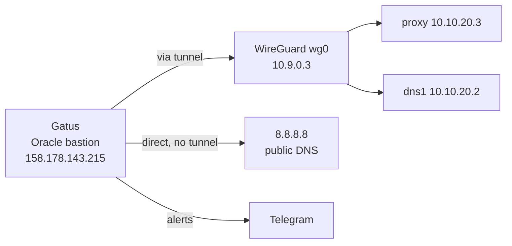

# External Monitoring — Gatus

Prometheus on CT 114 answers *"is this service healthy?"* from inside. Gatus
answers a different and equally important question: **"is the lab reachable from
the internet at all?"** Only something outside the network can answer that.



- URL: `http://158.178.143.215:8080` (or via the Oracle box's own reverse proxy)
- Config: `/home/ubuntu/docker/gatus-config.yaml`
- Container: `ghcr.io/twin/gatus:stable`
- Alerts: Telegram, **`@AhmedSydneyOracleAdmin_bot`** (bot id `8426343772`)

## What it watches

**35 endpoints in seven groups**, all passing as of 27 Sep 2026.

| Group | Watches | Why it is first |
|---|---|---|
| **1-access** | WireGuard tunnel, public DNS apex, internal DNS | If these fail nothing else matters |
| **2-tls** | wildcard certificate expiry | One cert covers every name |
| **3-infrastructure** | Proxmox, AdGuard, service register, **UniFi gateway**, **GS724T switch** | |
| **4-monitoring** | Grafana, Prometheus, Alertmanager, Loki, cAdvisor | If these are down, internal alerting is blind |
| **5-apps** | CouchDB, YamTrack, webhook, mailcatcher | |
| **6-media** | Plex, Stremio, Transmission, audiobookshelf, Glances, Dozzle | |
| **7** (work) | the 11 backends of a work dev stack on the MacBook | Expected down whenever that laptop is off |

Three checks earn their place more than the rest:

**Public DNS apex** queries `8.8.8.8` for `baig.network` and asserts the answer
equals the current WAN address. That catches the DDNS updater silently failing —
which is invisible from inside the network, because internal DNS never consults
the public record.

**WireGuard tunnel** checks the proxy through the tunnel. The proxy is
*unreachable* from Oracle except over wg0, so a successful response is proof the
tunnel works.

**Wildcard certificate** alerts below 10 days. This is a second, independent
pair of eyes on renewal — Prometheus watches the same thing from inside, and a
renewal failure could plausibly take out the machine doing the watching.

## Alerting was configured but wired to only 12 of 33 endpoints

Ten work endpoints sat red for hours with no Telegram message. The provider was
never the problem — `getMe` returns `AhmedSydneyOracleAdmin_bot` and a direct
`sendMessage` delivers.

> [!CAUTION]
> **`default-alert` supplies DEFAULTS for an alert; it does not create one**
> ```yaml
> alerting:
>   telegram:
>     token: "${TELEGRAM_BOT_TOKEN}"
>     default-alert:
>       failure-threshold: 3      # <- defaults only
> ```
> An endpoint with **no `alerts:` key has no alert at all** and can fail silently
> forever. Only 12 of 33 had one. This is easy to miss because the config looks
> complete and Gatus logs `configuredProviders=[telegram]` at startup — which
> confirms the provider parsed, not that anything is using it.
>
> Audit it rather than reading it:
>
> ```bash
> ssh -i ~/.ssh/oracle_id_rsa ubuntu@158.178.143.215 'python3 -c "
> import yaml
> d=yaml.safe_load(open(\"/home/ubuntu/docker/gatus-config.yaml\"))
> for e in d[\"endpoints\"]:
>     if not e.get(\"alerts\"): print(e.get(\"group\"), e[\"name\"])
> "'
> ```

Now **25 of 35** alert. The 10 in group 7 are silent **on purpose**: those
services live on the MacBook, which is off most of the time, so alerting on them
would page constantly and teach you to ignore the channel. Internal monitoring
makes the same exemption with a `job!=` matcher on `up == 0`. Their state is still on the
dashboard; it just does not wake anybody.

### Delivery is verified, not assumed

A throwaway endpoint pointed at an unroutable address was added with
`failure-threshold: 1`, and the log showed:

```
[watchdog.handleAlertsToTrigger] Sending initial telegram alert because alert
for endpoint=ALERT SELFTEST ... has been TRIGGERED
```

with no send failure. Then removed. Worth repeating after any change to the
alerting block — the first attempt at this test used
`https://this-host-does-not-exist.baig.network`, which **succeeded**, because the
`*.baig.network` wildcard sends it to the proxy and the catch-all redirects it to
the register, which Gatus follows to a 200. Use an unroutable IP
(`https://10.255.255.1/`), not a made-up hostname.

## What it deliberately cannot see

The WireGuard peer is narrow, by design (see [Remote Access](remote-access.md)):

| | |
|---|---|
| HTTPS through the proxy | works — every web service |
| DNS to dns1 | works |
| ICMP to lab hosts | **blocked** |
| TCP to database ports | **blocked** |

So Gatus does no host-level pings and no direct database checks. That is not a
gap in monitoring — Prometheus covers host and database health from inside, with
node_exporter and the three database exporters. Gatus covers the outside view.

If you *do* want external ICMP or database checks, it needs two more UniFi
policies from `10.10.50.20`. Until then, don't add endpoints for them — they
would sit permanently red and teach you to ignore the board.

## The rewrite

The previous config monitored a network that had stopped existing:

- `ahmedpi.ddns.net` endpoints — transmission proxy, pialert, camera, deluge,
  Pi-hole admin, Webmin — all now stopped on the Pi
- `192.168.0.118` — the **Windows workstation's** pre-VLAN address. It is now
  `win11`, VM 100 on `10.10.20.21`, and it is **stopped**, so these checks would
  sit red even corrected. See [Lab Map](lab-map.md)
- `internal.workstation.ahmedhome.com`, `adguard.workstation.ahmedhome.com` —
  the retired legacy domain

Almost every check was either failing or checking nothing. Old config kept as
`gatus-config.bak-prevlan-*.yaml`.

> [!WARNING]
> **The work API checks were red because they probed `/`**
> Nine of 33 endpoints sat failing while every service was healthy. The work
> backends are APIs with **no route at `/`**, so they return **400** — the app
> working, not failing — and the condition accepted 200/301/302/401/404.
>
> They now probe **`/metrics`**, which all nine serve (it is what Prometheus
> scrapes) and which returns 200. A 200 there proves the process is up *and*
> instrumented, which is a stronger signal than a root-path redirect.
>
> The API gateway returns 301 on any path and passes either way. Old config kept
> as a `.bak` file. Now **33/33 up**.

> [!NOTE]
> **Gatus condition syntax**
> Multiple acceptable values need an explicit comparator:
> `"[STATUS] == any(200, 302)"`. Writing `"[STATUS] any(200, 302)"` makes the
> container panic on startup with *invalid condition format*.

## Health checks that look like failures

Several services return non-200 when perfectly healthy, and the conditions
reflect that deliberately:

| Service | Healthy status | Why |
|---|---|---|
| CouchDB / Obsidian | **401** | Auth required; 401 proves it is running and enforcing |
| Plex | 200 or 401 | Depends on token presence |
| Transmission | 200, 401 or 403 | Returns 403 without a session header |
| Grafana, Prometheus | 200 or 302 | Redirect to login |
| Stremio, cAdvisor | 200 or 307 | Redirect to a sub-path |
| Loki | 200 on `/ready` only | Its root path has no handler and 404s |

## Alerting

```
failure-threshold: 3      three consecutive failures before alerting
success-threshold: 2      two successes to clear
send-on-resolved: true
```

Three failures at a 2-minute interval means roughly six minutes before a page.
That is deliberate — a single failed probe over a home internet connection is
noise, not news.

> [!IMPORTANT]
> **Gatus and Alertmanager use **different** bots, on purpose**
> The point is knowing where a message came from without reading it. An alert from
> `@AhmedSydneyOracleAdmin_bot` means *the outside view broke* — the lab is
> unreachable, or the tunnel is down. One from `@AhmedProxmox_bot` means internal
> monitoring noticed something while remaining perfectly reachable. Those call for
> different responses, and merging them into one chat throws that away.
>
> | Source | Bot | Bot id |
> |---|---|---|
> | Gatus, on Oracle | `@AhmedSydneyOracleAdmin_bot` | `8426343772` |
> | Alertmanager, on CT 114 | `@AhmedProxmox_bot` | `8719011328` |
>
> Both deliver to the same chat id (`6370471245`) because chat ids are per *user*,
> not per bot — so they arrive as two distinct conversations, not one merged feed.
