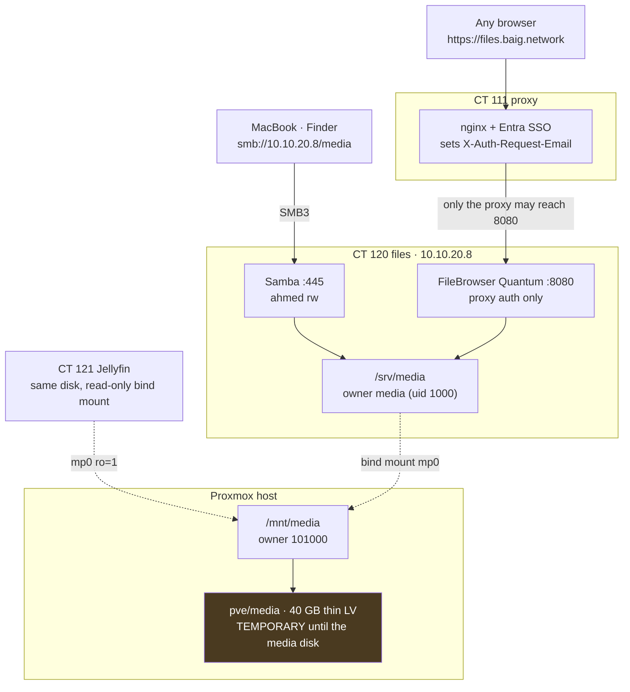

# File Server (CT 120)

Built 1 November 2026. One folder, two ways in, one reader:



| | |
|---|---|
| Container | CT 120 `files`, Servers VLAN, `10.10.20.8`, 2 cores, 1 GB, 8 GB rootfs, startup order 11 |
| Data | host `/mnt/media` → container `/srv/media` (`mp0`) |
| Folders | `Movies`, `TV Shows`, `Inbox` |
| SMB | `smb://10.10.20.8/media` (or `smb://files.servers.baig.network/media` — **not** `files.baig.network`, that is the proxy) — login `ahmed` |
| Web | https://files.baig.network — FileBrowser Quantum v2.0.2-stable behind Entra SSO |
| Code | `proxmox` repo: role `files`, `playbooks/files.yml`; secrets `homelab-secrets/ansible/files.sops.yaml` |

## Why it is built this way

- **Media server: Jellyfin on CT 121**, with the same host directory bind-mounted
  read-only and NVENC on the GTX 950 — see [Jellyfin](jellyfin.md). Plex on the Mac mini
  was retired the same day; the read-only `plex` Samba login went with it.
- **Bind mount, not a container disk.** The data lives on the host and is
  mounted in, so container backups never try to copy media, and moving to a
  real disk is a host-side change only.
- **Samba and FileBrowser write as one user.** Samba forces `media`, and
  FileBrowser runs as `media`, so a file dropped in either shows up in the
  other with the same owner. Unprivileged LXC maps container uid 1000 to host
  uid 101000, which is why `/mnt/media` is owned by `101000` on the host.
- **No password login on FileBrowser.** It trusts `X-Auth-Request-Email` from
  nginx and has password auth turned off. The admin is the SSO email
  (in the secrets file); anyone else SSO lets through gets a normal user.

> [!danger] The header is the login
> FileBrowser logs in whoever `X-Auth-Request-Email` names. Port 8080 is
> firewalled to `10.10.20.3` only. **Never open 8080 to anything else** — any
> host that can reach it can claim to be the admin with one curl.

## Firewall (nftables inside CT 120)

Policy drop on input. Nothing on the UniFi side was needed: Trusted → Servers
already exists and the Mac mini is in Servers.

| Port | Allowed from |
|---|---|
| 22 | Trusted `10.10.10.0/24`, Mac mini, Proxmox host |
| 445 | Trusted, WireGuard `10.10.50.20`, metrics `10.10.20.5` (probe) |
| 8080 | proxy `10.10.20.3` only |
| 9100 | metrics `10.10.20.5` |

Verified 1 Nov 2026 from the MacBook: 445 and 22 open, 8080 and 9100 closed;
from CT 111 8080 open; from CT 114 9100 and 445 open, 8080 closed.

## Monitoring

- Prometheus `node` job: `10.10.20.8:9100` (`host=files`, `role=files`).
- `blackbox-tcp`: `10.10.20.8:445`. `blackbox-http`: `https://files.baig.network`.
- Existing rules cover it: `ServiceDown`, `ExporterDown`, `DiskFillingUp`
  (< 10 % free — on the 40 GB volume that is 4 GB left).
- Grafana dashboard **Files and Jellyfin** (`baig-files`): space used, free, SMB / web /
  exporter status, network in and out, disk I/O, CPU and memory.
- Logs: Alloy ships the journal to Loki.
- Gatus: **Files** in group `6-media`, `200` or `302` (SSO redirect), Telegram alert.

## Storage: temporary volume now, real disk later

Proxmox has only the 256 GB NVMe. Until the media disk is bought the share sits
on a **40 GB thin LV** `pve/media` in the `local-lvm` pool, ext4, label `media`,
mounted by `/etc/fstab` with `nofail`. The pool was already over-provisioned
(sum of thin volumes 382 GB on a 157 GB pool); filling the media volume would
take the pool to ~82 %. Watch `DiskFillingUp`.

### Moving to the media disk

Single disk, no mirror — media is replaceable.

```bash
ssh root@10.10.20.20
lsblk -o NAME,SIZE,MODEL,SERIAL            # find the new disk, e.g. /dev/sda
mkfs.ext4 -L media-disk -m 0 /dev/sda       # whole disk, no partition table needed
mkdir -p /mnt/media-new && mount /dev/sda /mnt/media-new
pct stop 120
rsync -aHAX --info=progress2 /mnt/media/ /mnt/media-new/
umount /mnt/media /mnt/media-new
sed -i 's|^LABEL=media /mnt/media|LABEL=media-disk /mnt/media|' /etc/fstab
systemctl daemon-reload && mount /mnt/media
chown 101000:101000 /mnt/media && ls -ln /mnt/media
pct start 120
lvremove pve/media                          # only after checking the files
```

Nothing in either container, Samba, FileBrowser or Jellyfin changes — the path is the
same. Afterwards: `pct fstrim` is not needed (the LV is gone), and update this
note and [Proxmox and Containers](proxmox-and-containers.md#capacity).

## Getting the SMB password

The password is generated and only stored encrypted. On the MacBook:

```bash
sops -d --extract '["files_smb_rw_password"]' \
  ~/Work/PersonalProjects/homelab-secrets/ansible/files.sops.yaml | pbcopy
```

Finder → Go → Connect to Server → `smb://10.10.20.8/media`, user `ahmed`,
paste, tick *Remember this password in my keychain*.

> [!warning] `smb://files.baig.network` does not work
> Every flat `*.baig.network` service name resolves to the proxy (CT 111),
> which only speaks HTTPS. SMB needs the host name or the address.

## Open items

- [x] AdGuard exact rewrites for `files` and `jellyfin.servers.baig.network` (1 Nov 2026).
- [x] Service register cards on `home.baig.network` (1 Nov 2026). The page is
      now encrypted in the secrets repo, so the proxy playbook deploys it.
- [ ] Media disk, then the move above.
- [ ] Optional: `ffmpeg` in CT 120 for video thumbnails in FileBrowser, and a
      bigger cache directory (it warns below 20 GB free; the rootfs is 8 GB).

Related: [Jellyfin](jellyfin.md) · [Proxmox and Containers](proxmox-and-containers.md) · [Host Lifecycle](host-lifecycle.md) · [Migration Status](migration-status.md)
