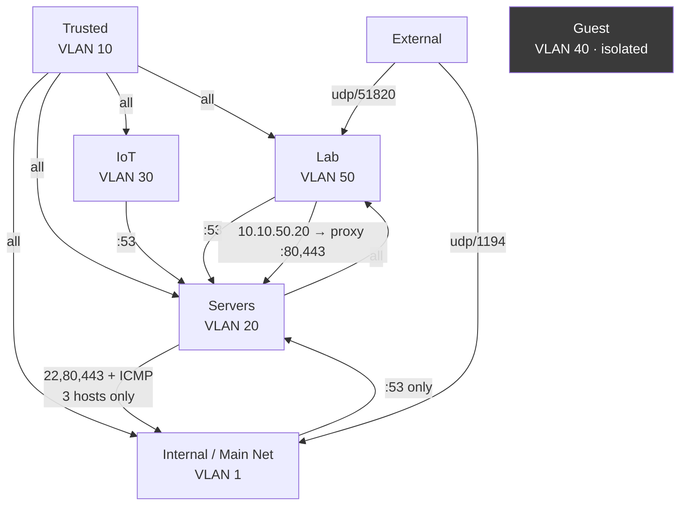

# Firewall Policies

Zone-based firewall on the UX7. Custom zones block each other by default; every
policy below is an explicit Allow with *Auto Allow Return Traffic* on, which
generates the paired `(Return)` rule automatically.



## DNS — every VLAN must reach dns1

| Policy | Source | Destination |
|---|---|---|
| `Guest DNS` | Guest | `10.10.20.2:53` |
| `IoT DNS` | IoT | `10.10.20.2:53` |
| `Lab DNS` | Lab | `10.10.20.2:53` |
| `Main Net DNS` | Internal | `10.10.20.2:53` |

These all used to list `10.10.20.10` as a second destination — the Mac mini,
back when it ran dns2. Nothing listens on port 53 there any more; those entries
were removed.

> [!NOTE]
> **A firewall rule is not enough on its own**
> Permitting a VLAN to reach dns1 does not make its clients *use* dns1. Each
> network also needs **DHCP Service → DNS Server → `10.10.20.2`**, or clients
> keep using the gateway and Leaptel answers for them.
>
> The PS5 is the standing example: it is online, it is permitted, and it has
> never queried dns1 — because PS5s keep a manual DNS setting in console
> settings that overrides DHCP. Fix it on the console, not the router.

## Lateral access

| Policy | What it is for |
|---|---|
| `Trusted → Internal / Servers / IoT / Lab` | the MacBook manages everything |
| `Servers → Lab` | Proxmox and the containers reaching CT 116 and CT 117. **Source-scoped**: the Mac mini (`10.10.20.10`) is NOT included, so it cannot ssh to `10.10.50.30` |
| `Servers → Main Net mgmt` | `22,80,443` to `192.168.0.3`, `.91`, `.119` only |
| `Servers → Main Net ICMP` | monitoring those same three |
| `VPN → Servers` | `10.10.50.20` → `10.10.20.3:80,443` — **source-scoped**, so other Lab hosts get nothing |

`Servers → Main Net mgmt` is what made the Pi manageable from Proxmox and the
GS724T switch reachable lab-wide. Three hosts, three ports — not the whole zone.

## Lab → Servers rules for CT 117 (`10.10.50.30`)

CT 117 is a Docker host running a private work test stack. These rules are what
let it reach the databases.

| # | Name | Source | Destination | Ports | State |
|---|---|---|---|---|---|
| 1 | `CT 117 → databases` | `10.10.50.30` | `10.10.20.4` | TCP `5432,3306,27017,6379` | **APPLIED 27 Sep 2026** ✅ |
| 2 | `Lab → Loki` | added to the existing Lab → Servers rule | `10.10.20.5` | TCP `3100` | **APPLIED 28 Sep 2026** ✅ — open from CT 117 |
| 3 | `CT 117 → proxy` *(optional)* | `10.10.50.30` | `10.10.20.3` | TCP `443` | not added, not required |
| 4 | `Mac mini → CT 117 ssh` *(optional)* | `10.10.20.10` | `10.10.50.30` | TCP `22` | not added — a `ProxyJump` via Proxmox works instead |

Zone pair is **Lab → Servers** in all three.

> [!WARNING]
> **Observed 28 Sep 2026: the database ports answer from the whole Lab VLAN**
> After the Loki change, CT 118 (`10.10.50.40`) and CT 119 (`10.10.50.41`) both
> connect to `10.10.20.4` on 3306, 5432, 6379 and 27017, although rule 1 names only
> `10.10.50.30`. The Lab → Servers rule appears to have been widened to the VLAN.
> That includes CT 116, the internet-facing VPN container, and Redis has no
> password. Re-scope rule 1 to `10.10.50.30` if that was not intended.

**Rule 1 is applied and verified** — not just open sockets, but real logins from
inside CT 117:

| Engine | Verified |
|---|---|
| MariaDB | 12 databases |
| PostgreSQL | 3 work databases, 153 tables |
| Redis | `PONG`, 110 keys |
| MongoDB | `DAU` 128.6 MB |

Redis at `6379` was included. Note that **Redis has no password**, by a decision
taken for a single trusted VLAN. It is scoped to the one host, so
the exposure is contained, but it is now reachable from a second VLAN.

**CouchDB (5984) is deliberately absent.** Nothing in this stack uses it.

> [!CAUTION]
> **Rule 2 fixes a gap that predates CT 117 — CT 116 has NEVER shipped logs**
> Alloy runs on CT 116 and has been failing since the container was built:
> `10.10.20.5:3100` is blocked from the Lab VLAN, so `host="vpn"` has **0 streams
> in Loki over 24h**. The WireGuard container is the internet-facing host, and its
> journal — sshd, unit failures, WireGuard events — has never been collected.
>
> That is why rule 2 should name **both** `10.10.50.20` and `10.10.50.30`. It is
> not new work for CT 117; it closes a monitoring hole that has been open all
> along and was only visible because a second Lab host made it obvious.

**Servers → Lab needs nothing.** Prometheus already scrapes `10.10.50.30:9100`
successfully — that direction was permitted before CT 117 existed, which is why
metrics work while logs do not. Metrics are *pulled* from Servers into Lab; logs
are *pushed* from Lab into Servers. Same two hosts, opposite direction, different
policy.

> [!CAUTION]
> **Scope to the host, not the VLAN**
> `10.10.20.3:443` is **open from `10.10.50.20`** and **blocked from
> `10.10.50.30`**, both on VLAN 50. The existing `VPN → Servers` policy names its
> source address, so a new host on the Lab VLAN inherits nothing. That is the
> behaviour you want — keep it by naming `10.10.50.30` rather than widening to
> `10.10.50.0/24`, or the isolation the VLAN provides quietly disappears.

Verify after applying, from the container itself:

```bash
ssh root@10.10.20.20 'pct exec 117 -- bash -c "
for t in 10.10.20.4:3306 10.10.20.4:5432 10.10.20.4:27017 10.10.20.5:3100; do
  h=\${t%%:*}; p=\${t##*:}
  printf \"%-22s \" \$t
  timeout 5 bash -c \"</dev/tcp/\$h/\$p\" 2>/dev/null && echo OPEN || echo BLOCKED
done"'
```

Then confirm an actual login rather than just a socket:

```bash
ssh root@10.10.20.20 'pct exec 117 -- mariadb -h db.servers.baig.network -u ahmed -p -e "show databases"'
ssh root@10.10.20.20 'pct exec 117 -- psql "postgresql://postgres@db.servers.baig.network/postgres" -c "\conninfo"'
```

## What the omissions cost

This is the part worth understanding, because each gap presents as a fault
somewhere else.

### No `Servers → Trusted`

**Consequence: every proxy entry for the work dev stack on the MacBook is dead**,
and Prometheus can never scrape it.

The chain is: Prometheus (Servers) → a work dev-stack hostname → resolves to
the proxy (Servers) → proxy must reach the MacBook (Trusted) → **blocked**. It
fails regardless of whether the MacBook is even on.

Fix, if you want those 11 services and their four Grafana dashboards working:

| Field | Value |
|---|---|
| Name | `proxy → MacBook (work dev stack)` |
| Src | `Servers` / `10.10.20.3` |
| Dst | `Trusted` / `10.10.10.10` |
| Ports | TCP `51000, 52100-52111` |

### No `Servers → Internal` beyond three hosts

The TV (`192.168.0.20`) and PS5 (`192.168.0.120`) are not reachable from
Servers, so they cannot be monitored. Deliberate — they are appliances.

### No ICMP from Servers to Trusted

The MacBook cannot be pinged from Prometheus. It was removed from the ICMP probe
list rather than left permanently red. It is obviously alive — it is the busiest
client on dns1.

### VPN clients cannot reach databases

`VPN → Servers` permits only `10.10.20.3:80,443`. Everything on the proxy works;
`10.10.20.4` does not. A leaked VPN key therefore does not hand over Postgres.

Add an explicit rule sourced from `10.10.50.20` if you need it. Do not widen the
existing one.

## Port forwards

| Name | Proto | Port | To | Source |
|---|---|---|---|---|
| `WireGuard` | UDP | 51820 | `10.10.50.20` | Any |
| `Pi VPN` | UDP | 1194 | `192.168.0.3` | Any |

Both accept any source, which is correct — see the reasoning in
[Remote Access](remote-access.md). Both `tls-crypt` OpenVPN and WireGuard are silent to
unauthenticated packets, so the ports are invisible to scanners.

`Pi Sydney` (TCP 80/443 → the Pi) was **deleted**. Apache on the Pi is stopped,
so it forwarded to nothing while the apex record resolves publicly.

## Removed, and why

| Policy | Why |
|---|---|
| `Servers/IoT/Lab → 192.168.0.117:53` | that address stopped existing at the VLAN rebuild |
| `Main Net → IoT / Lab / Trusted (temp)` | rebuild scaffolding; nothing on VLAN 1 needs them |
| `Main Net → Servers (temp)` | replaced by `Main Net DNS`, verified by the TV's 3,033 queries |
| `VPN -> DNS` | was created as **Block**, which would have broken VPN DNS. `Lab DNS` already covers it |
| `VPN → Databases` | created as **Block** with source zone `VPN`, a zone nothing uses — matched no traffic and was redundant |

## Untouched system rules

`Allow DHCPv6`, `Allow Link-Local DHCPv6`, `Allow Neighbor Advertisements /
Solicitations`, `Allow Router Advertisements`, `Allow IPTV Streaming IGMP /
Multicast`, `Allow mDNS`, `Allow Return Traffic`, `Block Invalid Traffic`,
`Isolated Networks` (Guest). All standard; leave them alone.

## Verifying a change

```bash
# Servers -> Main Net management
ssh root@10.10.20.20 'for t in 192.168.0.3 192.168.0.91 192.168.0.119; do
  printf "%-16s " $t; ping -c1 -W2 $t >/dev/null 2>&1 && echo ok || echo blocked; done'

# Servers -> Trusted (expected to fail until the work dev-stack rule exists)
ssh root@10.10.20.20 'pct exec 111 -- bash -c "timeout 4 bash -c \"</dev/tcp/10.10.10.10/52100\" && echo open || echo BLOCKED"'

# Whole-lab effect of any change
ssh root@10.10.20.20 'pct exec 114 -- python3 /root/verify-metrics.py'
```
