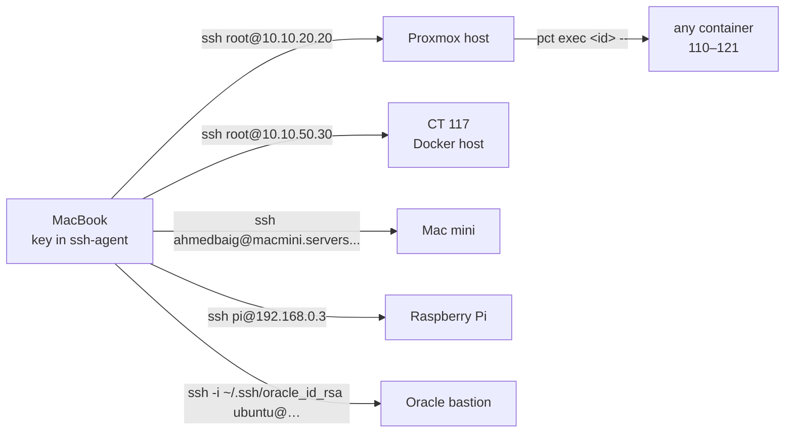

# Getting Around

How to reach every box in the lab and run things on it from a terminal. Every
command here was run against the live lab on 6 Nov 2026.

## The path in



One key opens the lab: root on the Proxmox host. From there `pct exec` runs any
command in any container, so the containers need no SSH server, keys or root
password of their own.

## Before the first command

The key is passphrase-protected. Load it once per login session or every SSH
call fails with `Permission denied (publickey,password)`:

```bash
ssh-add --apple-load-keychain      # macOS, passphrase comes from Keychain
ssh-add ~/.ssh/id_rsa              # anywhere else
```

Never let a script retry a failed login in a loop: three failures ban the source
address on the Pi (see [Known Traps](known-traps.md#fail2ban-can-lock-out-your-own-management-network)).

## Hosts

| Host | How | Notes |
|---|---|---|
| Proxmox host | `ssh root@10.10.20.20` | web UI `https://pve.baig.network` |
| CT 110–121 | `ssh root@10.10.20.20 'pct exec <id> -- <cmd>'` | ids and roles in the [Lab Map](lab-map.md) |
| CT 117 | `ssh root@10.10.50.30` | the only container with direct SSH |
| Mac mini | `ssh ahmedbaig@macmini.servers.baig.network` | Hermes agents, Stremio, Ollama |
| Raspberry Pi | `ssh pi@192.168.0.3` | OpenVPN |
| Oracle bastion | `ssh -i ~/.ssh/oracle_id_rsa ubuntu@158.178.143.215` | Gatus |

`pct list` on the host shows every container and whether it is running.

## Running things in a container

```bash
# one command
ssh root@10.10.20.20 'pct exec 112 -- systemctl status postgresql'

# a script: pipe it in, so there is only one layer of quoting
ssh root@10.10.20.20 'pct exec 114 -- bash -s' <<'EOF'
hostname
systemctl is-active prometheus loki prometheus-alertmanager
EOF

# copy files in and out (paths are on the host)
ssh root@10.10.20.20 'pct push 111 /tmp/baig.conf /etc/nginx/sites-enabled/baig.conf'
ssh root@10.10.20.20 'pct pull 114 /etc/prometheus/prometheus.yml /tmp/prometheus.yml'

# interactive shell
ssh -t root@10.10.20.20 'pct enter 115'
```

- Containers are Debian with no `sudo`. Switch users with `runuser -u <user> --`.
- Quoting: inside `ssh '…'` use double quotes; anything harder goes through
  `bash -s` with a quoted heredoc (`<<'EOF'`) so nothing expands on the Mac.

## Recipes

### Create a GitLab repo

Push to a path that does not exist yet; GitLab creates it as a private project.

```bash
git remote add origin git@gitlab.lab.baig.network:home-lab/<name>.git
git push -u origin main
```

Anything else (groups, settings, users) goes through the Rails console:

```bash
ssh root@10.10.20.20 'pct exec 118 -- gitlab-rails runner "
  puts Project.where(namespace: Group.find_by_full_path(%q(home-lab))).pluck(:path).sort"'
```

- `gitlab-rails runner` takes about 40 s to boot. Batch the work into one call.
- `Groups::CreateService` / `Projects::CreateService` need `organization_id`;
  copy it from an existing group.
- GitLab rejects a branch named `HEAD` and paths containing `---`.

### Grafana dashboards

Call the API from inside CT 115, where Grafana listens on `127.0.0.1:3000`. The
admin password is `grafana_admin_password` in the secrets repo
(`hosts/macmini.sops.yaml`).

```bash
ssh root@10.10.20.20 'pct exec 115 -- bash -s' <<'EOF'
read -rs PW                               # paste the password, nothing echoes
curl -s -u "admin:$PW" http://127.0.0.1:3000/api/search?type=dash-db | python3 -m json.tool
EOF
```

When saving a dashboard back:

- Fetch it first and pass `folderUid` from `meta.folderUid`. Without it the
  dashboard moves to General.
- Strip `id` and `version` only when exporting to git, never when saving.
- Dashboards under `/var/lib/grafana/dashboards/` are provisioned and read-only
  in the UI; change those files through the `grafana` Ansible role.
- Check panels after a change: `ssh root@10.10.20.20 'pct exec 115 -- python3 /root/audit.py'`.

More in [Monitoring](monitoring.md#dashboards).

### Prometheus and Loki

Both answer on the Servers VLAN, so query them from the host or the Mac:

```bash
curl -s 'http://10.10.20.5:9090/api/v1/query?query=up==0'                       # what is down
curl -s 'http://10.10.20.5:9090/api/v1/alerts'                                   # firing alerts
curl -sG 'http://10.10.20.5:3100/loki/api/v1/query_range' \
  --data-urlencode 'query={job="unifi"}' --data-urlencode 'limit=20'             # recent logs
ssh root@10.10.20.20 'pct exec 114 -- python3 /root/verify-metrics.py'           # whole-lab summary
```

New scrape targets go in `/etc/prometheus/prometheus.yml` on CT 114 (through the
`monitoring` role), then `systemctl reload prometheus`.

### Databases

```bash
ssh root@10.10.20.20 'pct exec 112 -- runuser -u postgres -- psql -c "\l"'      # PostgreSQL as superuser
ssh root@10.10.20.20 'pct exec 112 -- redis-cli ping'
mariadb -h db.servers.baig.network -u ahmed -p                                  # MariaDB, remote admin
psql -h db.servers.baig.network -U postgres                                     # PostgreSQL, remote
```

MariaDB `root` is local-only and needs `-u root -p` even inside the container.
See [Databases](databases.md#accounts).

### AdGuard Home

The API needs the Basic header, not `curl -u`, so the credential never lands in
shell output:

```bash
ssh root@10.10.20.20 'pct exec 110 -- bash -s' <<'EOF'
. /etc/default/dns-flow-metrics
curl -s -H "Authorization: Basic $ADGUARD_AUTH" http://127.0.0.1/control/status
EOF
```

### WireGuard peers

```bash
ssh root@10.10.20.20 'pct exec 116 -- /root/wg-peer.sh list'
ssh root@10.10.20.20 'pct exec 116 -- /root/wg-peer.sh add <name> split'
```

### Certificates

Renewal is automatic. To check or push it, see
[Runbooks](runbooks.md#renew-or-reissue-the-certificate).

### Mac mini and the Hermes agents

```bash
ssh ahmedbaig@macmini.servers.baig.network
hermes gateway status            # one gateway serves every profile
hermes -p argus cron list        # per-profile cron jobs
tail -f ~/.hermes/logs/gateway.log
```

The agents run on the Mac mini and have **no route into the lab**: the Mac
mini's key is passphrase-protected and has no agent loaded, so SSH to the
Proxmox host fails there by design. Lab work goes through a person on the
MacBook.

## Changing things for good

`pct exec` is for looking and for one-off fixes. Anything that should survive a
rebuild goes through this repo:

```bash
cd ansible
ansible-playbook playbooks/site.yml --check --diff </dev/null   # dry run, expect no changes
ansible-playbook playbooks/<role>.yml </dev/null                # apply one container
```

- Ansible reaches containers the same way, through the host
  (`community.proxmox.proxmox_pct_remote`).
- `</dev/null` avoids `requires blocking IO` on macOS.
- Secrets are decrypted from the private secrets repo with `sops` at run time.
- Copy a hand fix back into the role the same day, or the next playbook run
  undoes it ([Known Traps](known-traps.md#scripts-that-undo-your-changes)).

## Where the credentials are

| What | Where |
|---|---|
| SSH key | `~/.ssh/id_rsa` on the MacBook, passphrase in Keychain |
| Service passwords and tokens | private secrets repo, `ansible/<role>.sops.yaml` and `hosts/*.sops.yaml` |
| Everything else | Obsidian `Operations/Credentials.md` |

Never paste a credential into a command line; read it into a variable
(`read -rs`) or source it from a root-only file on the box.

Related: [Lab Map](lab-map.md) · [Runbooks](runbooks.md) · [Known Traps](known-traps.md)
