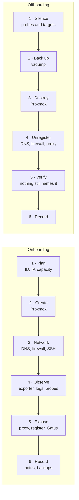

# Host Lifecycle — onboarding and offboarding

A host in this lab is registered in about fifteen places. Missing one does not
break anything on the day; it shows up weeks later as a red panel nobody trusts,
a DNS name that lands on the proxy, or a firewall rule that still names an
address someone else now owns.

Use this page for every new VM or container and every one that is removed.
Work top to bottom on the way in and bottom to top on the way out.



## Where a host is registered

| # | Place | Lives on | Needed when |
|---|---|---|---|
| 1 | Guest ID, address, startup order | [Lab Map](lab-map.md) fixed-address table | always |
| 2 | Proxmox guest config | `10.10.20.20` | always |
| 3 | AdGuard exact rewrite `<name>.<vlan>.baig.network` | CT 110 | always |
| 4 | Search domain | `pct set <id> --searchdomain` | containers |
| 5 | UniFi firewall policies naming the address | UX7 (manual, web UI) | host needs to cross VLANs |
| 6 | UniFi DHCP reservation | UX7 (manual) | VMs on DHCP |
| 7 | `authorized_keys` (Mac mini, MacBook, `root@pve`) and `known_hosts` on the Macs | the host, the Macs | always |
| 8 | Certificate distribution | `/root/distribute-certs.sh` on pve | host terminates TLS itself |
| 9 | node_exporter + Alloy | the host | always |
| 10 | Prometheus `node` / `blackbox-*` jobs | CT 114 `/etc/prometheus/prometheus.yml` | always |
| 11 | Host-specific Grafana dashboards | CT 115 | host has its own dashboard |
| 12 | nginx `server` block + service register | CT 111 `baig.conf`, `/var/www/hosts/index.html` | host serves a web UI |
| 13 | Gatus endpoint | Oracle `/home/ubuntu/docker/gatus-config.yaml` | service reachable through the proxy |
| 14 | Backup job | Proxmox (none configured yet) | host holds state |
| 15 | Vault notes | this vault | always |

## Onboarding

### 1. Plan

- **Pick the ID and address first**, and write them into [Lab Map](lab-map.md) before
  creating anything. The fixed-address table is the source of truth; a guest
  created first and documented later is how two things end up on one address.
- **Pick the VLAN deliberately.** Servers gets database access for free; Lab
  needs source-scoped Lab → Servers rules for everything. See
  [Firewall Policies](firewall-policies.md).
- **Check capacity.** Memory, not disk, is usually the limit:

  ```bash
  ssh root@10.10.20.20 'free -m; pvesm status; lvs pve/data'
  ```

  Sum of guest memory caps already exceeds physical RAM; that is fine while
  actual use stays well under 23 GB. Look at actual use, not caps. The thin
  pool (`local-lvm`) is the disk figure that matters — `local` is a different
  store.

### 2. Create

Containers: the recipe in [Proxmox and Containers — Container recipe](proxmox-and-containers.md#container-recipe). Always:

- `bridge=vmbr1` with the VLAN `tag` — never `vmbr0`
- `--searchdomain <vlan>.baig.network` **explicitly** (see [Runbooks — Add a new host (not a service)](runbooks.md#add-a-new-host-not-a-service))
- `--features nesting=1`, plus `keyctl=1` only if Docker will run inside
- `--onboot 1 --startup order=<n>`, ordered after anything it depends on
  (dns1 is 1, the databases are 3)

Inside, force IPv4 for apt and upgrade, as in the recipe.

### 3. Network

```bash
# DNS — exact rewrite, or the name falls into the *.baig.network wildcard
#   AdGuard → Filters → DNS rewrites → <name>.<vlan>.baig.network → <ip>
```

- **Firewall** — add UniFi policies that name **this host's address**, never
  the whole VLAN (see [Firewall Policies — Lateral access](firewall-policies.md#lateral-access)).
  A Lab host that should ship logs needs `→ 10.10.20.5:3100`.
- **SSH** — root key-only, three keys in `authorized_keys` (Mac mini, MacBook,
  `root@pve`). Record the fingerprints in the host's note.
- **Certificate** — only if the host serves TLS itself rather than through the
  proxy: add it to `distribute-certs.sh` and confirm the name is covered by the
  SAN list (one extra label only, see [Reverse Proxy and Certificates — Certificate](reverse-proxy-and-certificates.md#certificate)).

### 4. Observe

```bash
pct exec <id> -- apt-get install -y prometheus-node-exporter
# Alloy: /root/deploy-alloy.sh on pve, or the manual steps in [Runbooks — Create a container](runbooks.md#create-a-container)
```

Then on CT 114:

1. Add `<ip>:9100` to the `node` job, with the same labels as its neighbours.
2. If the host is reachable by ICMP from Servers, add it to `blackbox-icmp`.
   If it is not, **do not add it** — a permanently red probe teaches you to
   ignore red.
3. `promtool check config /etc/prometheus/prometheus.yml`, then reload.
4. Confirm with `python3 /root/verify-metrics.py` — every target up.

**All Hosts** and **Node Exporter Full** pick the host up from the `node` job
with no dashboard edits. Anything host-specific gets built, then exported by
`gather-configs.sh`, then `/root/audit.py` on CT 115 run against it.

If the host is expected to be down much of the time, exclude it from
`ExporterDown` the same way the work dev stack is, or it pages every evening.

### 5. Expose (only if it has a web UI)

- `server` block in `baig.conf` copied from a neighbour, `nginx -t`, reload —
  see [Runbooks — Add a new service](runbooks.md#add-a-new-service).
- Card on the service register.
- `blackbox-http` target on CT 114.
- Gatus endpoint on Oracle, **with an `alerts:` key**. An endpoint without one
  never alerts ([External Monitoring — Alerting was configured but wired to only 12 of 33 endpoints](external-monitoring.md#alerting-was-configured-but-wired-to-only-12-of-33-endpoints)).
  Gatus reaches only the proxy and dns1 through the tunnel — never add ICMP or
  direct-port checks for a lab host.

### 6. Record

- [Lab Map](lab-map.md) — diagram node and fixed-address row.
- [Proxmox and Containers](proxmox-and-containers.md) — inventory diagram, and capacity if it moved.
- [DNS](dns.md) — the rewrite list.
- [Firewall Policies](firewall-policies.md) — every rule added, with its state.
- [Monitoring](monitoring.md) / [External Monitoring](external-monitoring.md) — target and endpoint counts.
- A note of its own if the host does more than one thing.
- The private secrets repo — accounts and values, encrypted.
- [Known Traps](known-traps.md) — anything that bit during setup.

## Offboarding

### 1. Silence first

Remove the host's Prometheus targets and Gatus endpoints **before** stopping
it. Stopping first produces a burst of `ExporterDown` / `ServiceDown` pages and
an external alert for something you did on purpose.

### 2. Back up

```bash
ssh root@10.10.20.20 'vzdump <id> --storage local --mode stop --compress zstd'
ls -la /var/lib/vz/dump/
```

Keep the archive until you are sure nothing needs it, then delete it — `local`
holds ISOs and templates too, and it has no alert of its own. Skip the backup
only when the guest holds nothing (never booted, or rebuilt from a recipe).

### 3. Destroy

```bash
ssh root@10.10.20.20 'qm destroy <id> --purge --destroy-unreferenced-disks 1'   # VM
ssh root@10.10.20.20 'pct destroy <id> --purge --destroy-unreferenced-disks 1'  # container
```

`--purge` also removes the guest from backup jobs and replication.
Then delete any install ISOs only that guest used (`/var/lib/vz/template/iso/`).

### 4. Unregister

Reverse of onboarding steps 3–5:

- AdGuard rewrite
- UniFi firewall policies and DHCP reservation naming the address
- `distribute-certs.sh` entry
- nginx `server` block and register card
- host-specific Grafana dashboards (read `meta.folderUid` first if you are
  moving rather than deleting, see [Monitoring — Dashboards](monitoring.md#dashboards)), then re-run
  `gather-configs.sh` so the export drops them
- `known_hosts` on both Macs: `ssh-keygen -R <ip>`

### 5. Verify nothing still names it

```bash
IP=10.10.20.21; NAME=win11
ssh root@10.10.20.20 "grep -nE \"$IP([^0-9]|\$)|$NAME\" \
  <(pct exec 114 -- cat /etc/prometheus/prometheus.yml) \
  <(pct exec 111 -- cat /etc/nginx/conf.d/baig.conf) \
  <(pct exec 111 -- cat /var/www/hosts/index.html) \
  <(pct exec 110 -- cat /opt/AdGuardHome/AdGuardHome.yaml) \
  /root/distribute-certs.sh"
grep -rnE "$IP([^0-9]|\$)|$NAME" --include='*.md' ~/Documents/Obsidian\ Vault | grep -v /Archive/
```

Then Gatus on Oracle (`grep` the config) and the UniFi policy list by eye.
`verify-metrics.py` should report every remaining target up.

### 6. Record

Remove it from every note listed under onboarding step 6, and add a line to
the log below.

## Log

| Date | Host | Change |
|---|---|---|
| 2026-09-27 | CT 117 | created, Lab VLAN — Docker host for a private work test stack |
| 2026-09-28 | VM 100 `win11`, VM 101 `ml` | destroyed without backup (nothing needed). **Kept on purpose** for a rebuild: ISOs on `local`, AdGuard rewrites, the two Windows dashboards, the Lab Map addresses. Checked: no Prometheus targets, nginx blocks, register cards or cert distribution named them. **Not checked:** UniFi policies / DHCP reservations and the Gatus config (the Oracle key is only on the Mac mini; [External Monitoring](external-monitoring.md) says the old Windows checks were removed in the rewrite). Freed ~23 GB of thin pool (68.8 % → 54.3 %) |
| 2026-09-28 | CT 117 | `pct fstrim` returned 22 GB (pool 54 % → 46 %). Egress split: root and builds may use TCP 80/443, the runtime user `lab` is LAN-only, 192.168.0.0/16 never. Loki 3100 opened |
| 2026-09-28 | CT 119 `registry` | created (Lab, `10.10.50.41`, order 9): docker-registry on 443, htpasswd, GC timer; DNS, nginx, register card, certs, Alloy, node + blackbox targets. See [CI and Registry](ci-and-registry.md) |
| 2026-09-28 | CT 118 `gitlab` | created (Lab, `10.10.50.40`, order 10): GitLab CE 19.4.1; DNS, nginx, register card, certs, Alloy, node + blackbox targets; outbound locked to the lab |
| 2026-09-28 | CT 119 `registry` | `keyctl=1` + Docker for the registry UI (`registry-ui.baig.network`, register card, blackbox probe) |
| 2026-09-28 | CT 117 | `keyctl=1`, Docker, two GitLab runners, user `deploy` — see [CI and Registry](ci-and-registry.md) |
