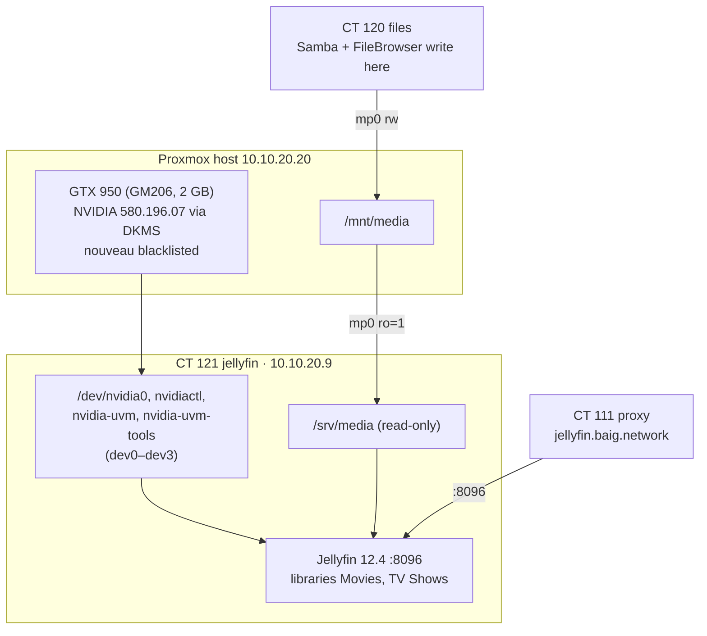

# Jellyfin (CT 121)

Built 1 November 2026, the same day Plex on the Mac mini was retired.
https://jellyfin.baig.network — `plex.baig.network` now 301s here.



| | |
|---|---|
| Container | CT 121 `jellyfin`, Servers, `10.10.20.9`, 4 cores, 4 GB, 24 GB rootfs, startup order 12 |
| GPU | `dev0..dev3` passthrough of the host's `/dev/nvidia*`; userspace driver **580.196.07** installed in the CT with `--no-kernel-modules` |
| Media | `/mnt/media` read-only at `/srv/media` — Jellyfin cannot delete anything |
| Transcoding | NVENC H.264; NVDEC H.264, HEVC (incl. 10-bit), MPEG-2, VC-1, VP9; tone mapping on; HEVC encode off |
| Login | local admin `ahmed`, password in `homelab-secrets/ansible/jellyfin.sops.yaml`; Entra SSO pending (below) |
| Code | `proxmox` repo: role `jellyfin`, `playbooks/jellyfin.yml` — wizard, libraries (folder watching on, TheMovieDb metadata — API-created libraries start with both off) and NVENC are set through the API |

Verified 1 Nov 2026: `nvidia-smi` in the CT shows the GTX 950; a 1080p
`h264_nvenc` test encode with `jellyfin-ffmpeg` succeeded; the playbook re-runs
with `changed=0`.

## Why

- **Jellyfin over Plex:** hardware transcoding in Plex needs Plex Pass; Jellyfin
  does NVENC for free.
- **GTX 950, not the CPU:** the i7-7740X has no iGPU. Maxwell NVENC is old but
  does H.264 well, and decodes 10-bit HEVC.
- **Not behind oauth2-proxy:** the TV and phone apps cannot follow an Entra
  redirect. Jellyfin keeps its own login.

## The NVIDIA driver — read before a Proxmox kernel update

Maxwell is only supported by the **580 legacy branch**; 590+ drop it. The
driver was installed from NVIDIA's `.run` with `--dkms`, so a new kernel
rebuilds the module automatically — **if** 580 compiles against it.

```bash
# host
ls /root/nvidia/                                    # the .run is kept here
dkms status                                         # nvidia/580.196.07, <kernel>: installed
nvidia-smi
cat /etc/modprobe.d/blacklist-nouveau.conf          # blacklist nouveau
cat /etc/modules-load.d/nvidia.conf                 # nvidia, nvidia_uvm at boot
cat /etc/udev/rules.d/70-nvidia.rules               # creates /dev/nvidia* (incl. uvm) at boot
```

> [!danger] Driver versions must match exactly
> The kernel module on the host and the userspace libraries in CT 121 must be
> the same version. Upgrading the host driver means running the same `.run` in
> the CT with `--no-kernel-modules` (`pct push 121 …`, then
> `sh NVIDIA-Linux-x86_64-<v>.run --silent --no-kernel-modules --no-x-check --no-opengl-files`).
> A mismatch shows as `Failed to initialize NVML: Driver/library version mismatch`.

> [!warning] Kernel 7.0 and the 580 branch
> Forum reports (Proxmox, Oct 2026) say early 580 builds failed on kernel 7.0
> and later ones work. 580.196.07 built cleanly on `7.0.14-17-pve`. If a kernel
> update breaks the DKMS build, the host still boots — Jellyfin just loses the
> GPU and falls back to CPU. Pin the previous kernel with
> `proxmox-boot-tool kernel pin <version>` until a newer 580 point release builds.

Installed live without a reboot: `nouveau` had no users, so the console was
unbound and `modprobe -r nouveau` worked. The blacklist is in the initramfs for
the next boot.

## Clients

- **Address:** `https://jellyfin.baig.network` in every app. Server discovery does not cross VLANs.
- **LG TV (`192.168.0.20`, Main Net):** needs the UniFi policy `TV -> Jellyfin` (→ `10.10.20.3` TCP 443, *Auto Allow Return Traffic* on).
- **Log in on a TV with Quick Connect:** the TV shows a code; approve it from a signed-in browser or phone (profile → Quick Connect). No typing the password with a remote.

## Monitoring

- Prometheus `node` job: `10.10.20.9:9100` (`host=jellyfin`, `role=media`).
- `blackbox-http`: `https://jellyfin.baig.network` (replaced `plex.baig.network`).
- Gatus: **Jellyfin** in `6-media`, `/health` must return `200` and `Healthy`
  (replaced the Plex check).
- Grafana: **Files and Jellyfin** dashboard, Jellyfin row.
- GPU metrics: `nvidia_gpu_exporter` is in the role but **off**
  (`jellyfin_gpu_exporter_enabled: false`) — it is a third-party binary and has
  not been approved. Port 9835 is already open to CT 114.

## Open items

- [ ] **Entra SSO.** Jellyfin 12 has no native OIDC (upstream targets 13). The
      original SSO plugin stops at 10.11; the K0lin fork v5.1.x targets 12.
      Needs an Entra app registration (redirect URI per the plugin README,
      `https://jellyfin.baig.network/sso/OID/redirect/<provider>` — check before registering). Local logins stay
      for the TV and phone apps, as Grafana and Proxmox keep theirs.
- [ ] Decide on the GPU exporter.
- [x] AdGuard rewrite `jellyfin.servers.baig.network → 10.10.20.9` (1 Nov 2026).
- [x] Service register card (1 Nov 2026).

Related: [File Server](file-server.md) · [Proxmox and Containers](proxmox-and-containers.md) · [Migration Status](migration-status.md)
