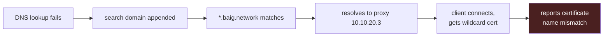

# Known Traps

Written down because most of these will happen again, and because several
presented as something completely different from their cause.

## The big one: failures that look like TLS errors



If you see `SSL: no alternative certificate subject name matches target
hostname` for a **public** hostname, the certificate is not the problem. The
name did not resolve. Check DNS first, every time.

This pattern cost time twice in one day — once on Docker's CDN, once on
CouchDB's apt repo.

## Network

| Symptom | Cause | Fix |
|---|---|---|
| Host loses all connectivity after a switch port move | `U` set on the new VLAN, PVID still 1 — traffic arrives but leaves on the wrong VLAN | PVID first, then `U`, then blank VLAN 1 |
| Container has an address but no internet | Attached to `vmbr0` (an **access** port) with `tag=`. Replies come back untagged and the tagged veth never sees them | Use `vmbr1` — the trunk. The old docs had this backwards |
| "Default gateway already exists" on vmbr1 | A host may have only one default gateway | vmbr1 gets no IP and no gateway |
| Proxmox UI drops every few minutes | Static address inside UniFi's DHCP pool — address clash | Fixed reservation in UniFi. If `journalctl -k` shows "Hardware Unit Hang", also disable TSO/GSO/GRO |
| VNC to the Mac mini works on Wi-Fi, fails across VLANs | Dual-homed: Ethernet on Servers, Wi-Fi on Main Net, so replies left by a different path and the stateful firewall dropped them | One interface per server — Wi-Fi off |
| `macmini.local` / Bonjour stops working | mDNS does not cross VLANs | Use the FQDN |
| ICMP monitoring shows Main Net hosts permanently down | No `Servers → Internal` firewall policy. Only `192.168.0.1` answers | Either add the policy or stop probing them |

## DNS

| Symptom | Cause | Fix |
|---|---|---|
| Scattered public names SERVFAIL; others fine | **Leaptel intercepts all port 53 traffic.** Unbound cannot resolve recursively when every hop is answered by an interceptor | Unbound forwards over DoT on 853. See [DNS](dns.md) |
| No DNS traffic reaching dns1 at all, tcpdump silent | UniFi **Content Filtering → Ad Block** hijacks port 53 | Turn Content Filtering off. *Separate issue from the ISP interception — both are real* |
| An `http://`-only device works by IP but not by name | The name is fine — `dig` proves it. Modern browsers upgrade a typed hostname to `https://`, and the device has no TLS, so it fails. The raw IP does not get upgraded the same way | Proxy it: give the name an nginx vhost with the real certificate and let nginx do the plain-HTTP hop. Done for `netgear.main.baig.network` and `router.baig.network` |
| A service register card is red while the service answers fine | The service sets `cross-origin-resource-policy: same-origin`, so the browser **blocks** a cross-origin `no-cors` fetch and the check rejects. The work dev-stack backends do this; they answer a 400 in 17ms and still showed red | Nothing to fix in the service. Mark the card `data-nocheck` — Prometheus and Gatus monitor them properly from the server side, which CORP does not affect |
| A name resolves to the gateway or the proxy instead of the host | AdGuard rewrites run before upstreams, and `*.baig.network` matches at any depth | Delete the offending wildcard; use exact rewrites for hosts |
| `dig: parse of /etc/resolv.conf failed` | A bare `search` line, left by `pct set --searchdomain ""`. glibc tolerates it, BIND does not | `pct set <id> --delete searchdomain`, then remove the stale line |
| Every unresolvable name returns the proxy | Proxmox node search domain was `servers,baig.network` — **comma, not dot** — which split into two search domains | `pvesh set /nodes/pve/dns --search servers.baig.network` |
| A work domain reached over the work VPN fails on lab DNS | Unbound `private-address` rebinding protection discards private answers for VPN-routed domains | `private-domain: <that domain>` |
| `get.acme.sh` SERVFAIL | Was blamed on DNSSEC; actually the ISP interception | Fixed by DoT |
| An AdGuard `@@` allowlist rule does not unblock the name | **`$important` on an allowlist rule stops it working.** `@@||ahmedpi.ddns.net^$important` left the name blocked by `\|\|ddns.net^` from a blocklist; the identical rule without `$important` allowed it immediately | Write allowlist rules plain: `@@\|\|host.example^`. Confirm with `/control/filtering/check_host`, which queries the engine directly and bypasses the DNS cache |
| A monitoring panel says queries are leaving on plain port 53 | Almost certainly a classification bug, not a leak. `top_upstreams_responses` reports a **domain-scoped** upstream like `[/servers.baig.network/]10.10.20.1` as bare `10.10.20.1:53`, so "not loopback ⇒ internet" wrongly counts internal lookups and local PTR as egress, and files `tls://` fallbacks as plain | Classify by address **and** scheme: loopback, private, `tls://`, or public-and-plain. **Do not remove the gateway upstreams** — they resolve the per-VLAN domains and the reverse lookups that name clients |
| Unbound's cache hit rate looks terrible (0.3%) | Not a fault. AdGuard answers ~60% from its own cache first, so Unbound only ever sees the misses | Judge caching on AdGuard's figure, not Unbound's |
| `unbound-control stats` reports no query types or rcodes | `extended-statistics` is off by default — 55 counters instead of 147, and no TLS counters at all | `extended-statistics: yes`. Cost is not measurable at this query volume |

## Containers

| Symptom | Cause | Fix |
|---|---|---|
| Console rejects every password on a new container | `pct create` without `--password` leaves root **locked** | `pct exec <id> -- passwd root`, or just `pct enter <id>` |
| Container fails to start with a `/dev/kmsg` error | That device does not exist in an unprivileged LXC | Remove the `devices:` mapping. cAdvisor runs fine without it |
| ICMP probes always return `probe_success 0` | Unprivileged LXC blocks raw sockets; `CAP_NET_RAW` does not help | Run blackbox-exporter on the Proxmox host |
| Proxmox warns "Systemd 257 detected. You may need to enable nesting" | It means it | `--features nesting=1` |
| `Permission denied (publickey,password)` to Proxmox although the key is authorised | The local key is passphrase-protected and non-interactive SSH cannot prompt | `ssh-add ~/.ssh/id_rsa` first |

## Databases

| Symptom | Cause | Fix |
|---|---|---|
| 6 GB of data with no recognisable name | Compose files declared no `volumes:`, so Docker created **anonymous** volumes. One `down -v` from deletion | Native packages, or bind mounts under `/opt/data/` |
| `ERROR 2026 "SSL is required, but the server does not support it"` | MariaDB 11.4+ clients require TLS by default; the 10.11 server has none | `--skip-ssl` for one-off transfers |
| Every `mariadb` command suddenly needs credentials | Giving `root@localhost` a password replaces unix-socket auth | `-u root -p<password>` everywhere |
| `su - hive` fails restoring a database | `hive` is a **PostgreSQL role**, not a Linux user | Restore over TCP as that role |
| PostgreSQL will not start after installing a certificate | It refuses a group-readable key | Its own copy, owned by `postgres`, mode `0600` |
| Restore appears to have 214 mismatched tables | `n_live_tup` and `table_rows` are **estimates** and disagree on statistics age | Compare exact `COUNT(*)` |
| Wiki.js in a permanent reconnect loop | `DB_HOST=y192.168.0.117` — a stray `y`, and `.117` stopped existing at the VLAN rebuild | Both fixed; Wiki.js retired anyway |

## Monitoring

| Symptom | Cause | Fix |
|---|---|---|
| Loki loses all logs on reboot | Packaged config uses `path_prefix: /tmp/loki` | `/var/lib/loki`, and chown to `loki:nogroup` |
| Retention configured but nothing is deleted | `retention_period` does nothing without the compactor | `compactor: { retention_enabled: true }` |
| Alloy ships nothing, service looks healthy | The `alloy` user is not in `systemd-journal` | `usermod -aG systemd-journal alloy` |
| Loki rejects entire batches as "too old" | Alloy replays each container's full history on first run | `stage.drop { older_than = "24h" }` |
| Provisioned Grafana dashboard appears missing | Grafana 13 stores dashboards in unified storage, not the `dashboard` table | Query the `resource` table |
| adguard-exporter runs, logs nothing, exposes nothing | It wants `-adguard_hostname`, not `ADGUARD_SERVERS`. The env var is silently ignored and it polls `127.0.0.1` | Pass flags, and set `entrypoint:` — the image has none, so `command:` would replace the binary |
| Gatus shows endpoints down but no Telegram alert arrives | The endpoint has no `alerts:` key. `default-alert` under the provider supplies **defaults for** an alert, it does not create one — so an endpoint without `alerts:` can fail forever in silence. Ten work endpoints did exactly that | Audit with a script, not by reading: list every endpoint where `not e.get("alerts")`. `configuredProviders=[telegram]` in the log only proves the provider parsed |
| A deliberately-broken test endpoint passes | `https://made-up-name.baig.network` resolves via the `*.baig.network` wildcard to the proxy, whose catch-all **302s to the service register**, and Gatus follows redirects to a 200 | Use an unroutable IP such as `https://10.255.255.1/` for failure tests |
| A "certificate invalid" alert fires for a healthy service | A rule keyed on `probe_success` catches any failing HTTPS probe. Loki's root path 404 tripped it | Removed; availability is `ServiceDown`'s job |
| Internet Speed dashboard goes flat, nothing looks broken | **pm2 drives the speedtest schedule and nothing resurrected it after a reboot.** `pm2 startup` was never run, so the daemon was simply gone | `com.baig.pm2.plist`, a *user* LaunchAgent — `pm2_home` is under `~` and the Wi-Fi test needs a user context. Alert on the age of `speedtest_last_run_timestamp_seconds`, never on whether a process is up |
| The Wi-Fi speedtest series stops but the wired one continues | `en1 is not active` — Wi-Fi is off. The script refuses to publish rather than pass wired numbers off as Wi-Fi | Working as intended. Turn Wi-Fi on if the comparison is wanted |
| A pm2 cron job shows `stopped` | That is the healthy state for `cron_restart` with `autorestart: false`. It runs, exits, and waits | Nothing to fix. Not the same as a crashed daemon |
| A Loki panel errors with "maximum number of series (500) reached" | Grouping by raw nginx `path`. 589 distinct paths over 6h, mostly query strings | Normalise inside the query with `label_format` + `regexReplaceAll` before grouping — strip `?...`, collapse `_local/<docid>` and numeric ids. Gives 158, and a normalised route is what you want from a proxy anyway |
| A table grows unnamed extra columns nobody added | A new scrape label. The panel's `organize` transformation excludes the labels that existed when it was written, and a later one just appears | Exclude the whole topology set (`site`, `role`, `kind`, …), or better, strip them in a recording rule so the panel needs no exclude list at all |
| A recording rule drops a label and it is still there | Prometheus renamed it. A collector label colliding with a scrape label becomes `exported_<name>` | Name both: `without(kind, exported_kind)` |
| Editing a dashboard through `/api/dashboards/db` moves it to General | Omitting `folderUid` on the POST is read as "no folder" | Always pass `folderUid`, read from `meta.folderUid` of the dashboard you fetched |
| An empty timeseries panel looks like a broken query | For a security signal — non-standard HTTP methods, say — empty *is* the healthy answer, but Grafana renders "No data" | Use a stat with `noValue` set to something like "none seen" |

## Windows VMs

| Symptom | Cause | Fix |
|---|---|---|
| Installer sees no disk | No VirtIO SCSI driver | Load `vioscsi\w11\amd64` from the virtio-win CD |
| No network after install | No VirtIO NIC driver | `NetKVM\w11\amd64`, then `virtio-win-guest-tools.exe` |
| VM stuck at UEFI boot manager | Both CD drives held the same ISO, and it was an unofficial build | Official Microsoft ISO, one CD each |
| Microsoft download error 715-123130 | The download page blocks VPN / Private Relay / ad-blocked DNS | Generate the link on a phone over mobile data |

## Miscellaneous

- **`/25` vs `/24`** — Main Net really is `192.168.0.0/25`. Keep `/25` for
  anything still on Main Net.
- **AdGuard memory** — 102 blocklists, several in duplicate formats, needed
  8 GB. Slimming the list was offered and declined.
- **Phantom UniFi client** at `10.10.20.122` (MAC ending `:7c`) keeps
  reappearing after being forgotten. Parked, harmless.
- **`config/` in the context pack drifts.** `AdGuardHome.yaml` there was a
  stale export that disagreed with the live config; `baig.conf` matched
  byte-for-byte. Verify against the box before trusting either.

## Services that were never broken

Three things looked broken today and were not. Recognising this pattern saves
hours.

| Looked like | Actually was |
|---|---|
| "OpenVPN died on the Pi" | A **duplicate unit** crash-looping. `openvpn@server` was running fine the whole time; `openvpn-server@server` could not bind udp/1194 because of it |
| "My phone can't connect to the VPN" | The UX7's source allowlist dropped it. The server logged one client all day — the Oracle box, which was whitelisted. Zero TLS errors, zero auth failures: the packets never arrived |
| "yamtrack doesn't work" | It served a login page correctly. The database was empty because yamtrack 0.26 ignores `DATABASE_URL` and silently used a hidden internal SQLite |

The common thread: **check whether the thing reached the service at all** before
debugging the service. A server with no failed attempts in its log is not the
problem.

## Config that is silently ignored

| Software | Reads | Ignores | Failure mode |
|---|---|---|---|
| yamtrack 0.26 | `DB_HOST`, `DB_NAME`, `DB_USER`, `DB_PASSWORD`, `DB_PORT` | **`DATABASE_URL`** | falls back to SQLite inside the container; 8,757 tracked items accumulated in an unmounted volume |
| ebrianne/adguard-exporter | `-adguard_hostname` flags | **`ADGUARD_SERVERS`** | starts, logs "Starting HTTP server", polls `127.0.0.1`, exposes nothing. No error even at debug level |
| Grafana Alloy | labels you set explicitly | — | `log_type` without `job` meant the entire Logs & Security dashboard matched nothing |

None of these produce an error. All three appear healthy.

## Scripts that undo your changes

**`/home/pi/changeIP.sh`** runs every 5 minutes as root. It only acts when the
WAN address *changes* — and then it flushes iptables, sets `INPUT DROP`, and
re-allows only `192.168.0.0/24`. Every lab subnet is denied.

That is why manual firewall fixes on the Pi "worked and then stopped": the fix
survived until the next WAN change. Patched to include `10.10.0.0/16`, verified
by applying the ruleset with a 90-second auto-revert armed.

**`/home/pi/startProcess.sh`** ran every 5 minutes and restarted the camera,
Deluge, the OVPN monitor and Apache. Disabling those services was pointless
until this cron entry was commented out.

> [!TIP]
> **Before debugging why a service came back, check cron**
> `sudo crontab -l`, `crontab -l`, and `/etc/cron.d/*`. On the Pi there was also
> a nightly `shutdown -r +5` at 16:00, which is why the journal showed a fresh
> boot every day at 16:05.

## fail2ban can lock out your own management network

Three failed SSH logins from the Mac mini banned `10.10.20.10` on the Pi, taking
out the whole Servers VLAN. The Pi was reachable from Proxmox but not from the
Mac mini, which looked like a routing fault.

`/etc/fail2ban/jail.local` now has:

```
ignoreip = 127.0.0.1/8 ::1 10.10.10.0/24 10.10.20.0/24 10.10.50.0/24 192.168.0.0/25
```

Any host that manages other hosts needs its network in `ignoreip`.

## Docker host (CT 117)

Found while bringing up a private work test stack on CT 117 (28 Sep 2026).

- **Restored MariaDB objects need their definers.** Triggers and views restored
  from the old server were created by `root@'%'` and an application account; on
  CT 112 root is local-only, so every write that fired a trigger failed with
  `ER_NO_SUCH_USER: The user specified as a definer ('root'@'%') does not exist`.
  Fixed by creating both accounts **locked**, with `ALL` on that one database only.
  Check `information_schema.TRIGGERS` / `VIEWS` `DEFINER` after any restore.
- **Shells hang behind an outbound lock.** powerlevel10k downloads `gitstatusd`
  from GitHub on the first prompt and oh-my-zsh checks for updates; with egress
  blocked the pane just sits at "fetching gitstatusd". Pre-install with
  `~/powerlevel10k/gitstatus/install -f` and set
  `zstyle ':omz:update' mode disabled`.
- **Prisma clients copied from a Mac carry macOS engines.** A Node service failed
  with "Prisma Client could not locate the Query Engine". The schemas only list
  `linux-musl` (Docker) and `darwin-arm64`; add `"native"` and
  `prisma generate` on the host.
- **`jump`'s amd64 release assets are ARM binaries** (`exec format error`). Build
  it with `go install github.com/gsamokovarov/jump@latest`.
- **Nine `tsc -w` watchers need ~6 GB.** An 8 GB container runs out before the
  servers start; run the builds under nodemon and rebuild one at a time.
- **`yarn install` leaves a multi-GB cache** in `/usr/local/share/.cache/yarn`
  (5.4 GB here) — clean it on a 20 GB disk.
- **`runuser -u lab` keeps root's `HOME` and `SHELL`.** A tmux server started that
  way gives every pane `HOME=/root`, and yarn then fails writing its cache. Pass
  `env HOME=/home/lab USER=lab SHELL=/bin/bash` explicitly.
- **A second tmux server does not read root's config.** The `lab` server started
  with `base-index 0`, so a `send-keys -t …​.1` hit "can't find pane: 1". `lab`
  now has a copy of `/root/.tmux.conf` and `/root/.tmux`.
- **nodemon checks npm for updates on every start.** With `lab` confined, those
  requests show up as `104.16.x.34` (npm's Cloudflare edge) in the `dropped` set.
  Harmless, and a good sign the rule works; not a service calling out.
- **App configs copied from a Mac carry live endpoints.** Third-party API URLs and
  keys in a config file point at the real services, with real credentials. A
  container that can reach the internet must have them repointed (done on CT 117)
  or be confined, or both.
- **AdGuard's `ADGUARD_AUTH` is a pre-encoded Basic header.** Pass it as
  `-H "Authorization: Basic $ADGUARD_AUTH"`. Given to `curl -u` it is treated as a
  username, curl prompts for a password and echoes the value (it did, 28 Sep 2026).
- **Containers do not share `localhost`.** Configs written for a laptop address
  other services as `localhost:<port>`; in a compose stack those become service
  names, and host-side stubs become `host.docker.internal`. Generate the rewrite;
  hand-edited copies drift.
- **nginx refuses to start if one `proxy_pass` host does not resolve.** In a half-deployed compose stack every
  missing front end kills the whole proxy (`host not found in upstream`). Use `resolver 127.0.0.11` and a variable
  in `proxy_pass` so names are looked up per request.
- **A manual deploy job shows status `created`, not `manual`, until its `needs` finish.** Scripts that decide
  "is this job automatic?" from the jobs API get it wrong; use CI lint (`dry_run=true&include_jobs=true`,
  field `when`).
- **`POST …/merge_requests/:iid/pipelines` answers 405 right after the MR is created** — GitLab is still checking
  it (`detailed_merge_status: checking`/`commits_status`). Retry after ~10 s.
- **A second tmux server inherits `default-shell` from the copied config.** User `lab` got root's
  `.tmux.conf` with `default-shell /bin/zsh` but no zsh setup; `set -a; . lab.env` then did not export, so
  processes started without their environment and fell back to Mac defaults (`/opt/homebrew/.../mysql`). Use
  the user's own login shell for its tmux.
- **CI builds fill the disk fast.** Base images, per-job layers and build cache reached 24 GB in a few hours;
  when the disk is full `yarn` does not fail, it retries "network trouble" forever. Prune after builds.
