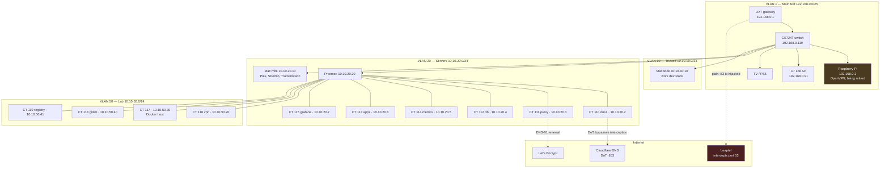

# Lab Map

Everything about the Lidcombe lab. Domain **baig.network**. Nothing is exposed
to the internet; inbound is via VPN only.

## Start here

- [Network Topology](network-topology.md) — physical wiring, VLANs, firewall zones
- [Firewall Policies](firewall-policies.md) — every zone rule, what it unblocks, what it costs
- [Remote Access](remote-access.md) — WireGuard, OpenVPN, and how anything gets in
- [DNS](dns.md) — AdGuard, Unbound, and why this network cannot resolve recursively
- [Proxmox and Containers](proxmox-and-containers.md) — what runs where, and the bridge that bites
- [Databases](databases.md) — CT 112, five engines, migration status
- [Reverse Proxy and Certificates](reverse-proxy-and-certificates.md) — nginx, the wildcard, renewal
- [Monitoring](monitoring.md) — Prometheus, Loki, Grafana, alerting
- [External Monitoring](external-monitoring.md) — Gatus on the Oracle bastion, seen from outside
- [Known Traps](known-traps.md) — everything that has broken, and why it will again
- [Migration Status](migration-status.md) — what has moved off the Mac mini, what has not
- [Host Lifecycle](host-lifecycle.md) — onboarding and offboarding checklist for every VM and container
- [CI and Registry](ci-and-registry.md) — lab GitLab, registry and runners

## The whole lab in one diagram

## Addressing at a glance

| VLAN | Name | Subnet | Domain | Zone |
|---|---|---|---|---|
| 1 | Main Net | `192.168.0.0/25` | — | Internal |
| 10 | Trusted | `10.10.10.0/24` | `home.baig.network` | Trusted |
| 20 | Servers | `10.10.20.0/24` | `servers.baig.network` | Servers |
| 30 | IoT | `10.10.30.0/24` | `iot.baig.network` | IoT |
| 40 | Guest | `10.10.40.0/24` | — | Guest (isolated) |
| 50 | Lab | `10.10.50.0/24` | `lab.baig.network` | Lab |

Gateway is always `.1`. IPv6 is off everywhere.

## Fixed addresses

| Host             | Address                     | Notes                                     |
| ---------------- | --------------------------- | ----------------------------------------- |
| UX7 gateway      | `192.168.0.1` / `10.10.x.1` |                                           |
| GS724T switch    | `192.168.0.119`             | HTTP only, no TLS                         |
| U7 Lite AP       | `192.168.0.91`              | management stays on VLAN 1                |
| Raspberry Pi     | `192.168.0.3`               | OpenVPN only — **kept**, not retired      |
| Proxmox host     | `10.10.20.20`               | web UI `:8006`                            |
| dns1 (CT 110)    | `10.10.20.2`                | AdGuard Home + Unbound                    |
| proxy (CT 111)   | `10.10.20.3`                | nginx, wildcard cert                      |
| db (CT 112)      | `10.10.20.4`                | Postgres, MariaDB, Mongo, Redis, CouchDB  |
| metrics (CT 114) | `10.10.20.5`                | Prometheus, Loki, Alertmanager            |
| apps (CT 113)    | `10.10.20.6`                | yamtrack, webhook, mailcatcher, exporters |
| grafana (CT 115) | `10.10.20.7`                | dashboards                                |
| vpn (CT 116)     | `10.10.50.20`               | WireGuard udp/51820 + web UI on 10086     |
| Mac mini         | `10.10.20.10`               | Plex, Stremio, Transmission               |
| MacBook          | `10.10.10.10`               | wired, en7                                |
| win11 (VM 100)   | `10.10.20.21`               | **destroyed 28 Sep 2026**; address and DNS rewrite kept for a rebuild |
| ml (VM 101)      | `10.10.50.10`               | **destroyed 28 Sep 2026**; address and DNS rewrite kept for a rebuild |
| gitlab (CT 118)  | `10.10.50.40`               | lab GitLab CE — see [CI and Registry](ci-and-registry.md)   |
| registry (CT 119) | `10.10.50.41`              | lab Docker registry — see [CI and Registry](ci-and-registry.md) |
| CT 117 | `10.10.50.30` | Debian 13, Docker host running a private work test stack. Needs Lab→Servers firewall rules — see [Firewall Policies](firewall-policies.md) |

## Naming

- **Services are flat**: `grafana.baig.network`, `obsidian.baig.network`. All
  resolve to the proxy, which routes on the `Host` header. Moving a service
  means editing one `proxy_pass` line.
- **Hosts are per-VLAN**: `db.servers.baig.network`, `macbook.home.baig.network`.
  These resolve straight to the device.

## Live index

**https://home.baig.network** lists every nginx entry with a live
reachability dot, a copy button for the hostname, and a filter box. Served
from `/var/www/hosts/index.html` on CT 111.

The dots are checked from your browser, so they show what *you* can reach —
which differs by VLAN. The switch, for example, only answers from Trusted.
