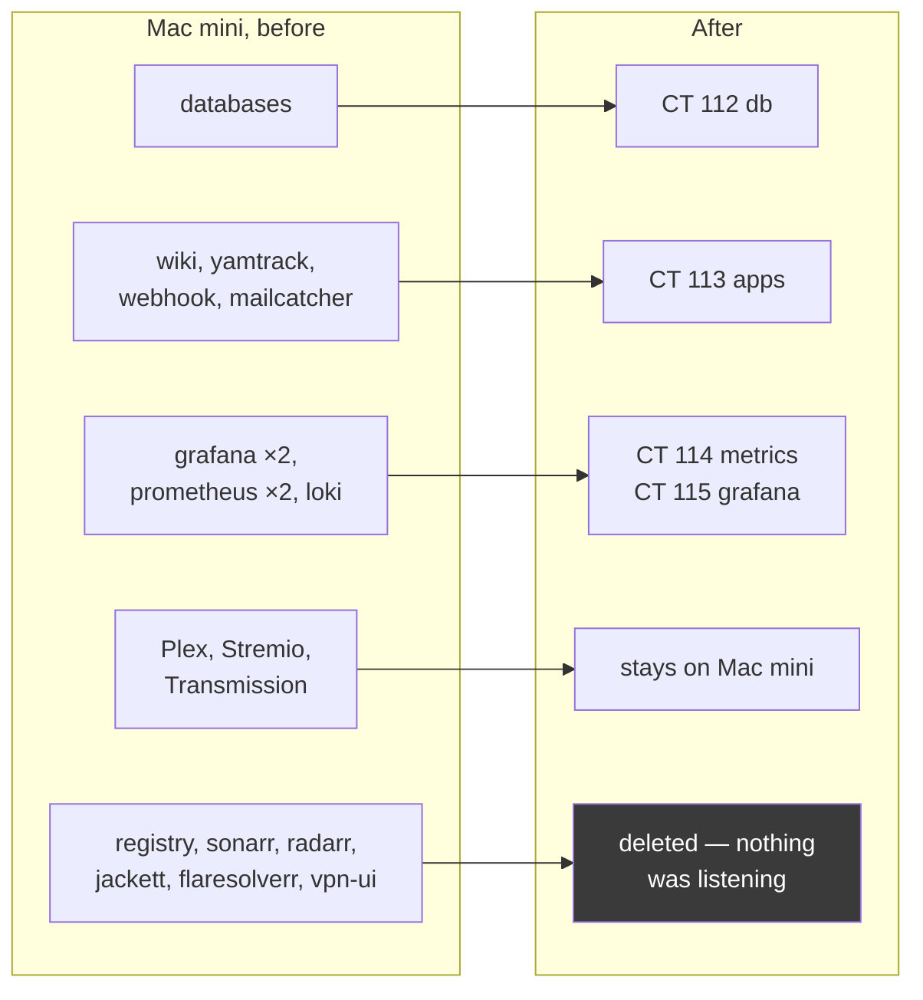

# Migration Status

The rebuild moves services from the Mac mini onto Proxmox containers. The Mac
mini keeps media only.



## Done

| Service | From | To | State |
|---|---|---|---|
| PostgreSQL, MariaDB, Mongo, Redis | Mac mini Docker | CT 112 native | **staged copy, verified** |
| CouchDB | — | CT 112 | new, live |
| yamtrack | Mac mini | CT 113 | live |
| webhook-tester | Mac mini | CT 113 | live, now with persistent storage |
| mailcatcher | Mac mini | CT 113 | live |
| Prometheus ×2 | Mac mini | CT 114, merged to one | live |
| Loki | Mac mini | CT 114 | live, persistent storage |
| Grafana ×2 | Mac mini | CT 115, merged to one | live, 17 dashboards, all exported to git |
| Wiki.js | Mac mini | **Obsidian** | content exported, service retired |

## Stays on the Mac mini

Plex (native app, not a container), Stremio, Transmission, audiobookshelf,
metabase, mongo-express, Portainer, dozzle, glances, node_exporter.

Dozzle and glances are per-host by nature and still earn their place now that
the Mac mini keeps running media services.

## Deleted — nothing was listening

`registry` 6452, `sonarr` 8989, `radarr` 7878, `jackett` 9117,
`flaresolverr` 8191, `vpn-ui` 5152.

`vpn-ui` was the long-standing mystery in the old docs. It is simply dead.

That also means the **1–2 TB SSD no longer gates anything** — the planned media
container is moot, since Plex stays put and the *arr stack does not exist.

## Left to do

### 1. Database cutover

CT 112 holds a verified copy, but applications still point at the Mac mini and
the two have been diverging since the restore.

```
1. Quiesce writers
2. Delta re-dump the write-heavy work schemas
3. Repoint applications to db.servers.baig.network
4. Verify with exact COUNT(*) on both sides
5. Stop the Mac mini database containers (do NOT use -v)
```

Decisions still open: keep or drop two old work databases. Dumps are retained either way
in `/var/tmp/migration` on CT 112.

### 2. Retire the Mac mini's own nginx

It still listens on 80/443 and is no longer routed to. Along with it go the
legacy `ahmedhome.com` rewrites.

### 3. ~~Pi decommission and WireGuard~~ — changed course

**The Pi is no longer being decommissioned.** It keeps running OpenVPN
indefinitely, and everything else on it has been stopped.

WireGuard now runs in parallel on CT 116, and the Oracle box has already
moved to it — so the dependency that made the Pi load-bearing is gone, but
the Pi stays as a second way in. See [Remote Access](remote-access.md).

### 4. Firewall tidy

Delete stale policies 6–8 (they point at `192.168.0.117`, which no longer
exists), narrow 9–12, then flip the default posture to Block All.

Consider also **adding** `Servers → Trusted` and `Servers → Internal` if you
want the MacBook, Pi, AP and switch to be monitorable — see [Monitoring](monitoring.md).

### 5. ~~Telegram alerting~~ — done

Alertmanager and Gatus both send to `@AhmedProxmox_bot`. The chat ID
(`6370471245`) was recovered from the old Gatus config header; chat IDs are
per-user, so it worked with the new bot without needing `getUpdates`.

### 6. Credential rotation

Everything was kept at parity with the Mac mini so cutover stays a single
variable. Once applications are repointed, rotate the Postgres, MariaDB and Mongo
passwords. Redis has no auth at all.

These are also committed in `~/work/linux-setup-toolkit/docker/`.

### 7. Export remaining dashboards to files

Only the Service Health dashboard is provisioned from a file. The other 14 live
only in `grafana.db` and would be lost if the container were rebuilt.
