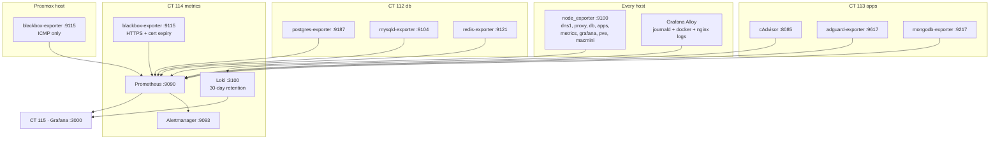
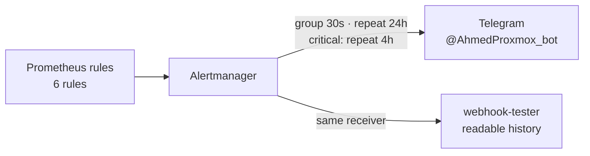

# Monitoring

Two containers: **CT 114 metrics** (`10.10.20.5`) collects, **CT 115 grafana**
(`10.10.20.7`) displays. Split deliberately so a Grafana restart never
interrupts collection.

## Data flow



## Scrape targets

**56 targets, all up** as of 27 Sep 2026. A work dev stack lives on the
MacBook and is legitimately down whenever that laptop is off — those nine are
scraped so dashboards work when it is on, but **excluded from alerting** with a
`job!=` matcher on `up == 0`.

The nine work targets are up and **are** producing application metrics — 9
`nodejs_version_info` series, 8 Prisma `sub_module`s, 1331
`http_request_duration_seconds_bucket` series. An earlier note here claimed the
stack was not running; that was wrong, and the cause was an auditing bug.

| Job | Targets | Where |
|---|---|---|
| `node` | 8 | every container, the Proxmox host, the Mac mini |
| `blackbox-http` | 20 | every live service, over HTTPS |
| `blackbox-icmp` | 4 | gateways and hosts that are actually reachable |
| `cadvisor` | 1 | CT 113 |
| `postgres` / `mariadb` / `redis` / `mongodb` | 4 | CT 112 and CT 113 |
| `adguard` | 1 | CT 113, scraping dns1 |
| `prometheus` / `loki` / `alloy` / `alertmanager` | 4 | self |
| work dev stack | 9 | MacBook, expected down |

## Logs

Every Linux host runs **Grafana Alloy** shipping its systemd journal to Loki.
sshd, sudo, unit failures and kernel messages all land in the journal on
Debian, so one source covers the security-relevant material.

Extra sources:

- **CT 111** also ships nginx `access.log` and `error.log`, parsed into
  structured fields. This is the highest-value source in the lab for security
  work — every request to every service passes through the proxy, so it is the
  one place that sees probing, unexpected `Host` headers and auth failures.
- **CT 113 and the Mac mini** also ship Docker container logs.

Labels available for querying:

```
host, unit, level, ident, job, container, stack, stream, log_type, method, status, filename
```

### Useful queries

```logql
# Failed SSH authentication across the whole lab
{job="systemd-journal", unit="ssh.service"} |= "Failed password"

# Every non-2xx response the proxy served in the last hour
{log_type="access"} | status =~ "4..|5.."

# Requests for hostnames that do not exist — scanning
{log_type="access"} |= "444"

# Anything at error level or worse, any host
{job="systemd-journal", level=~"err|crit|alert|emerg"}

# One container's output
{job="docker", container="yamtrack"}
```

> [!WARNING]
> **Loki's packaged config stores data in `/tmp`**
> The Debian/Grafana package ships `path_prefix: /tmp/loki`, which loses every
> stored log on reboot. It is now `/var/lib/loki` with 30 days of retention.
>
> Retention only applies when the **compactor** runs with
> `retention_enabled: true`. Setting `retention_period` alone deletes nothing.

> [!NOTE]
> **Alloy replays history on first run**
> A new Alloy reads each Docker container's log from the beginning — some Mac
> mini containers date to 2025 — and Loki rejects anything older than
> `reject_old_samples_max_age`, failing entire batches including current lines.
> The Mac mini config has a `stage.drop { older_than = "24h" }` for this.

## Alerting



| Alert | Fires when | Severity |
|---|---|---|
| `CertificateExpiringSoon` | < 21 days | warning |
| `CertificateExpiringCritical` | < 7 days | critical |
| `ServiceDown` | `probe_success == 0` for 10 min | warning |
| `ExporterDown` | `up == 0` for 10 min, excluding the work dev stack | warning |
| `DiskFillingUp` | < 10 % free for 30 min | warning |
| `MemoryPressure` | < 10 % available for 30 min | warning |

Certificate alerts repeat every 24 h rather than every 4 — certificates expire
on a scale of weeks, and a warning that repeats hourly is one you learn to
ignore.

The single `telegram` receiver fans out to **both** a `telegram_configs` and a
`webhook_configs` pointing at webhook-tester on `10.10.20.6:8083`. Telegram is
the alert that reaches you; webhook-tester is a local, credential-free history
you can scroll when you want to know what fired last Tuesday.

Alerts matching `severity = "critical"` go to the same receiver but repeat every
**4 hours** instead of 24.

> [!NOTE]
> **Internal and external alerts use different bots**
> Alertmanager sends as `@AhmedProxmox_bot` (`8719011328`). Gatus on the Oracle
> box sends as `@AhmedSydneyOracleAdmin_bot` (`8426343772`), so the sender alone
> tells you whether the problem is internal or whether the lab has fallen off the
> internet. See [External Monitoring](external-monitoring.md).

### One inhibit rule

`ExporterDown` suppresses `ServiceDown` for the same `instance`. When a host goes
away both fire, and the second tells you nothing the first did not — without this
a single dead container produces two pages.

## Dashboards

Grafana **13.2.2**, migrated from the Mac mini's 12.0.1 by copying
`grafana.db` — which carries dashboards, datasource UIDs and users together, so
nothing needed re-linking. Zero migration errors across that two-version jump.

**17 dashboards**, in five folders:

| Folder | Dashboards |
|---|---|
| Overview | All Hosts · Infrastructure Overview · Service Health · WireGuard VPN |
| Services | DNS — AdGuard · Databases · Internet Speed · Logs & Security |
| Hosts | Host & Network — Mac mini · Node Exporter Full |
| Work | four application dashboards for the work dev stack |
| Other | Hive — Claude fleet · Windows — Host & Network · Windows — Service Health |

Three are **provisioned from files** under `/var/lib/grafana/dashboards/`
(`service-health.json`, `all-hosts.json`, `wireguard.json`) so they survive a
rebuild of the container. The other 14 exist only in Grafana's database.

All 17 are now **exported through the API** by `gather-configs.sh` into
`proxmox_sydney_1/ct115-grafana/dashboards-export/`, so there is a git history of
them and a rebuild is recoverable. `id` and `version` are stripped on the way out
— they are install-specific, and leaving them in makes every export show a diff.

> [!WARNING]
> **That export directory is deliberately not the provisioned path**
> Anything dropped into `/var/lib/grafana/dashboards/` becomes **read-only in the
> UI**. The 14 database-only dashboards are still being edited there, so they are
> backed up rather than provisioned. Moving one into provisioning is a decision to
> stop editing it by hand.

> [!CAUTION]
> **Editing via the API moves the dashboard to General**
> `POST /api/dashboards/db` without `folderUid` is read as "no folder", and the
> dashboard silently leaves its folder. Three did exactly that during this
> session's fixes and had to be moved back. Always read `meta.folderUid` from the
> dashboard you fetched and pass it back:
>
> ```python
> cur = get(uid)
> put({"dashboard": cur["dashboard"], "folderUid": cur["meta"]["folderUid"],
>      "overwrite": True})
> ```

> [!NOTE]
> **Grafana 13 moved dashboards out of the legacy SQLite table**
> They now live in unified storage (the `resource` table). Counting rows in
> `dashboard` will show a stale number and make you think provisioning failed.
>
> ```bash
> sqlite3 /var/lib/grafana/grafana.db \
>   "SELECT name FROM resource WHERE resource='dashboards' ORDER BY name;"
> ```

### The two Grafanas and two Prometheuses

There used to be one of each too many:

| | Dashboards | Verdict |
|---|---|---|
| `grafana` :3000 v12.0.1 | 14 | canonical |
| `grafana-metrics` :3123 v10.3.3 | **0** | removed |
| `prometheus` :9090 | 48 targets | canonical |
| `prometheus-metrics` :9190 | 9 targets, **all down**, all legacy names | jobs folded in, removed |

Both duplicates were empty or dead, so the merge required no reconciliation.
`grafana-metrics.baig.network` and `prometheus-metrics.baig.network` were
removed from nginx; the surviving names serve everything.

## Dashboard state, audited 27 Sep 2026

Every panel on every dashboard was run against its own datasource, and each was
also checked for overlapping `gridPos` and for garbled titles. **No dashboard has
a layout overlap.**

| Dashboard | Panels | Verdict |
|---|---|---|
| All Hosts | 7 | healthy |
| Infrastructure Overview | 16 | healthy |
| Service Health | 9 | healthy |
| WireGuard VPN | 9 | healthy |
| DNS — AdGuard | 25 | healthy; gained the traffic flow row |
| Databases | 36 | healthy |
| Internet Speed | 28 | **fixed** — stray `kind`/`role` columns, see below |
| Logs & Security | 19 | **fixed** — two Loki panels exceeded the series limit |
| Host & Network — Mac mini | 22 | healthy |
| Node Exporter Full | 122 | healthy on Linux hosts; blanks when `$node` is the Mac mini |
| Work × 4 | 98 | **replaced with imported copies**, see below |
| Hive — Claude fleet | 16 | no data — no `hive_*` metrics are being produced |
| Windows × 2 | 34 | no data — VM 100 was destroyed 28 Sep 2026; dashboards kept for a rebuild |

Hive and the two Windows dashboards are empty for reasons outside monitoring:
nothing is producing those metrics. They are not broken panels.

### Importing dashboards from another Grafana

Three of the work dashboards were imported from the Grafana they are used in, so
the lab runs the same JSON rather than a drifting copy. They kept their original
uids, so links and bookmarks still work. What had to change on import, and why:

- **Datasource uid.** The source install's Prometheus uid differs from the one
  here (`fen19il3pklq8c`). A global string replace covers all three spellings the
  files use — the `{type,uid}` object, a bare `{uid}` with no `type`, and the
  legacy `"datasource": "<uid>"` string inside `templating`.
- **`id` and `version` dropped.** Install-specific; carrying them across either
  412s or clobbers the wrong dashboard.
- **Pinned instance reset.** One dashboard pinned `instance` to an address that
  does not exist here, so it would have rendered empty until someone noticed the
  dropdown.
- **A missing `job` variable added.** A deprecated row filters on `job=~"$job"`
  but no such variable is defined in the source file.

One dashboard was still pointed at `benm27pjf0zr4a` ("prometheus-1"), a leftover
duplicate datasource aimed at the *same* `10.10.20.5:9090`. All four now use the
canonical one.

### A dashboard can look completely dead while Prometheus has every metric

Two of the imported work dashboards showed **nothing** on first open, and the
cause was one absent field.

A templating variable with no `datasource` falls back to Grafana's **default**
datasource. That default was **Loki**. So `label_values(nodejs_version_info,module)`
ran against Loki:

```bash
# via Prometheus — the 9 modules
curl -su admin:PASSWORD \
  'http://10.10.20.7:3000/api/datasources/uid/fen19il3pklq8c/resources/api/v1/label/module/values'

# via Loki — this is what the dashboard was actually getting
curl -su admin:PASSWORD \
  'http://10.10.20.7:3000/api/datasources/uid/aen18i6tw61a8a/resources/api/v1/label/module/values'
# {"message":"404 page not found\n"}
```

`$module` and `$instance` came out empty, so every panel query matched nothing.

Fixed two ways, because one alone is not enough:

1. **Every query variable now names its datasource explicitly.** Remapping uids on
   import only fixes references that *exist*; an absent one inherits silently.
2. **Prometheus is now the default datasource**, not Loki. Loki being default was
   an accident of creation order and turned every missing reference into silent
   emptiness. Verified first that Logs & Security names its datasource on all 20
   of its targets, so nothing depended on the old default.

> [!WARNING]
> **This audit script could not have caught it, and now has a check for it**
> `/root/audit.py` queries Prometheus **directly**, so it never exercises Grafana's
> datasource resolution — which is precisely why it reported these dashboards fine
> while the UI showed nothing. It now flags any query variable with no datasource
> as a layout/config issue. A green audit is evidence about PromQL, not about what
> the browser renders.

### The panels that are still empty, and why

Every remaining empty panel is a metric this build does not emit or a request
path only the real deployment serves. Nothing to fix:

| Panels | Cause |
|---|---|
| 3 × `PUBSUB channel latency` / `count` / `sum` | `redis_pubsub_latency_seconds_*` has **0 series** here |
| 4 request-path panels | paths only the real deployment serves |
| 11 in Prisma's *Database [Deprecated: view only purpose]* row | all `prisma_pool_*` / `prisma_client_*` have **0 series** |
| 2 on the services dashboard | `redis_pubsub_messages_received_total`, channel-subscription latency |

Backups of the pre-import dashboards are on CT 115 in
`/root/dash-backup/<uid>.pre-import.json`.

### What was actually wrong

**Internet Speed — two unnamed columns.** The "ISP, server and addresses" table
showed `kind` and `role` as bare extra columns. `speedtest_info` gained them when
the Prometheus scrape config was rewritten with `site`/`role`/`kind` labels, and
the panel's `organize` transformation predated them. It now excludes the whole
topology label set rather than the two that happen to exist today.

This is the general trap: **an `organize` exclude list rots.** It names the labels
present when the panel was written, and a label added later just appears. Where it
matters, strip the labels in a recording rule instead — then the panel needs no
exclude list at all and cannot rot.

**Logs & Security — past Loki's series limit.** "Distinct paths" and "Top 10
requested paths" grouped by raw nginx `path`. nginx serves **589 distinct paths
over 6h**, past Loki's 500-series cap, so both returned an error rather than data.
Paths are now normalised inside the query before grouping:

```logql
| label_format path=`{{ regexReplaceAll "/[0-9]+($|/)"
    (regexReplaceAll "/_local/[^/]+"
      (regexReplaceAll "[?].*" .path "") "/_local/:doc") "/:id${1}" }}`
```

That strips query strings (460 of the 589), collapses CouchDB `_local/<docid>`
(one per Obsidian LiveSync round) and turns numeric id segments into `:id`.
589 → 158. Grouping by a normalised route is also what you actually want from a
reverse proxy: `/lxc/112/status` and `/lxc/116/status` are one route.

**"Non-standard HTTP methods" looked broken when it was fine.** It returns
nothing, which is the healthy answer, but an empty timeseries renders as "No
data". It is now a stat with `noValue: "none seen"`.

> [!NOTE]
> **Auditing dashboards: interpolate the variables, and mind the matcher**
> Panel queries contain `$host`, `$job` and `$__rate_interval`. Sending them raw
> to Prometheus produces parse errors that look like broken panels.
>
> Substituting is not enough on its own. A variable inside an **exact** matcher
> has to become a regex matcher too — `instance="$node"` naively substituted
> gives `instance=".*"`, which is an exact match against those three characters
> and matches nothing. That produced a second wave of false failures after the
> first pass had already been corrected for the parse errors.
>
> Better still, resolve `$node`/`$job` to a value that genuinely exists and to a
> **valid pair**. Picking the first value of each label independently paired
> `instance="10.10.10.10"` with `job="adguard"` — a combination belonging to
> neither — and reported all 122 Node Exporter Full panels as broken.
>
> Two further traps, both found while importing the work dashboards, both now
> fixed in `/root/audit.py`:
>
> **A variable is not "any value of that label".** It is the result of its own
> `definition` query with its own `regex` applied. `label_values(
> nodejs_version_info,instance)` + `/^([^:]+):/` yields
> a bare hostname; the first value of `instance` across all metrics is
> `10.10.10.10`, which belongs to no target of that dashboard. That single error
> reported 60+ working panels as broken and produced the false conclusion that
> the stack was down.
>
> **A variable set to `All` is not one value.** Grafana expands it to an
> alternation of every value, so pinning the first reports a panel empty whenever
> the data lives under a different one — the `redis_pubsub` panels looked broken
> because the alphabetically-first module is not the one those metrics come
> from.
>
> **Panels inside a collapsed row do not occupy the main grid.** Flattening them
> into one coordinate space and checking overlaps reported Prisma's pie chart as
> colliding with a panel inside its deprecated row.

## The DNS traffic flow map

A "Traffic flow" row at the top of **DNS — AdGuard** shows every query from the
host that asked to where the answer came from. Three renderings of the same data,
a built-in **Node Graph** and a **bar gauge**, plus the plain figures.

Nothing in the stack produced the data, so two textfile collectors on CT 110 do:

| Collector | Emits | Why it exists |
|---|---|---|
| `unbound-metrics.py` | `unbound_*` — queries, cache, rcodes, query types, recursion time, **established sockets to port 853** | Debian 13 has no packaged unbound_exporter |
| `dns-flow-metrics.py` | `dns_flow_edge_queries`, `dns_flow_node_queries`, `dns_flow_path_queries`, `dns_flow_client_queries`, `adguard_upstream_*`, `unbound_infra_*` | The graph edges, and the AdGuard upstream figures the exporter omits |

Both run from systemd timers (30s and 60s). `dns-flow-metrics.py` reads the
AdGuard API directly, with credentials in `/etc/default/dns-flow-metrics`
(mode 600, not collected into git).

> [!IMPORTANT]
> **The adguard-exporter does not expose the upstream legs**
> `top_upstreams_responses` and `top_upstreams_avg_time` are both returned by the
> AdGuard API and neither appears in the packaged exporter. They are the only
> place the AdGuard → Unbound and AdGuard → gateway volumes exist as real
> numbers, which is why those legs were invisible until now.

### What counts as measured, and the one thing that does not

Every edge value comes from AdGuard's rolling 24h window, so the Sankey is
internally consistent and the four paths **reconcile exactly** against
`num_dns_queries`. The only figures not directly counted are Unbound's own
cache/recursion split, derived from its measured ratio and labelled
`basis="ratio"` to keep them distinguishable from `basis="counted"`.

The **client-to-outcome path is deliberately absent**. AdGuard reports per-client
totals and per-upstream totals but never the cross-tab between them, so drawing
which client's queries were blocked would be invention, not measurement.

### What the map showed

**Nothing leaves the network unencrypted.** `dns_queries_leaving_unencrypted` is 0,
and roughly **81%** of queries never leave at all — AdGuard's own cache, blocks, and
internal name lookups against the UniFi gateway.

**`1.1.1.1` is ten times slower than the alternatives** — 481 ms smoothed RTT
against 50 ms for `1.0.0.1` and 52–70 ms for both Quad9 addresses. Unbound is
already deprioritising it, which is what the infra cache is for.

> [!CAUTION]
> **I first reported a 5,500/day plain-port-53 leak. It was a collector bug.**
> The collector treated every non-loopback AdGuard upstream as internet egress. But
> the gateway upstreams are **domain-scoped** to the per-VLAN domains, and
> `local_ptr_upstreams` sends local reverse lookups there too — none of that leaves
> the network. The `tls://` fallback was also filed as plain.
>
> The recommendation that followed — remove the gateway upstreams — would have
> broken internal name resolution *and* the client naming on the flow map itself.
> Upstreams are now classified by address and scheme. See [DNS](dns.md).

> [!NOTE]
> **Unbound's cache hit rate is 0.3% and that is correct**
> AdGuard answers ~60% of queries from its own cache before Unbound ever sees
> them, so Unbound only ever gets the misses. Judge caching on AdGuard's figure.

> [!NOTE]
> **`num.query.tls` is not the upstream leg**
> It counts queries that *arrived* over TLS — Unbound acting as a DoT server.
> Unbound has no counter proving its **outbound** leg is encrypted, so
> `unbound_upstream_connections` counts established sockets to port 853 from the
> kernel instead. That is stronger evidence anyway: a silent fallback to plain 53
> would otherwise look like normal operation.

## Speedtests

Collection runs on the **Mac mini**, not Proxmox, because the wired-vs-Wi-Fi
comparison needs that machine's two interfaces. Two pm2 jobs from
`ecosystem.config.cjs`: wired at `:00/:30`, Wi-Fi at `:10/:40`, offset so the two
are never on the WAN together. Results reach Prometheus through the native
node_exporter's textfile collector, so nothing extra is scraped.

Cost is real and deliberate: roughly **0.9 GB per test**, about 45 GB/day for the
wired series alone. `speedtest_transferred_bytes_total` tracks the actual figure.

> [!CAUTION]
> **pm2 does not come back after a reboot on its own**
> The schedule had silently stopped: the pm2 daemon was not running, no startup
> hook had ever been installed, and the Internet Speed dashboard was flat from
> 26 Sep with nothing looking broken. Fixed with `com.baig.pm2.plist` — a **user**
> LaunchAgent, not the system daemon `pm2 startup` generates, because `pm2_home`
> is under `~` and the Wi-Fi test needs a user context.
>
> The lesson generalises: **alert on the age of
> `speedtest_last_run_timestamp_seconds`, never on whether a process is up.** A
> scheduler that is simply absent looks identical to a quiet network.

> [!NOTE]
> **A pm2 cron job showing `stopped` is healthy**
> With `cron_restart` and `autorestart: false`, pm2 launches the script, the
> script exits, and the entry waits in `stopped` until the next firing. It is not
> a crashed daemon.

The **Wi-Fi series stopped separately on 20 Sep**: `en1 is not active`, because
Wi-Fi is off on the Mac mini. The script verifies from the interface byte counters
that the test really went over Wi-Fi and refuses to publish otherwise, rather than
passing wired numbers off as Wi-Fi. That series stays flat until Wi-Fi is on.

## What is deliberately not monitored

| Thing | Why |
|---|---|
| Pi, AP, GS724T switch | Unreachable from the Servers VLAN — no `Servers → Internal` firewall policy |
| MacBook ICMP | Same, no `Servers → Trusted` policy. It is plainly alive — busiest client on dns1 |
| Mac mini cAdvisor | On macOS, Docker runs inside a VM and cAdvisor cannot read host cgroups |
| registry, sonarr, radarr, jackett, flaresolverr, vpn-ui | Nothing is listening on any of them, anywhere |

Probing things that can never answer only teaches you to ignore red.
