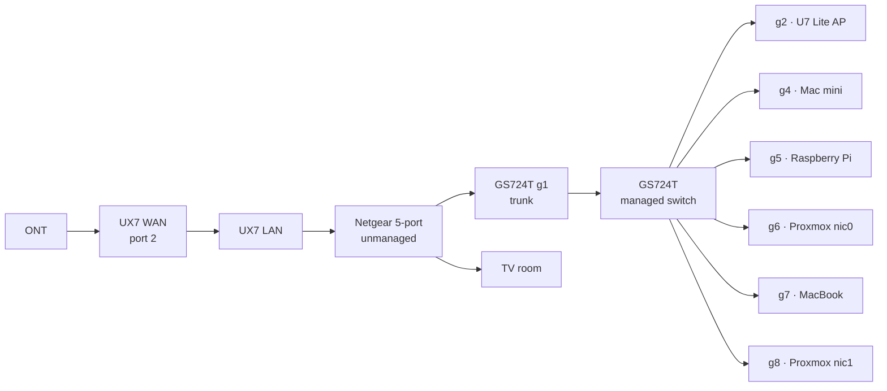
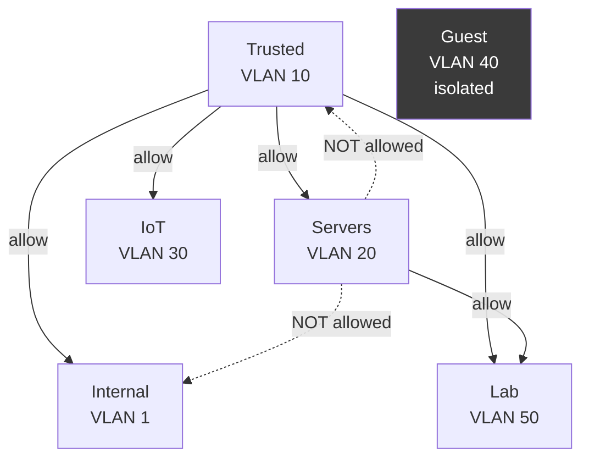

# Network Topology

## Physical path

The 5-port unmanaged switch in the middle cannot be removed — it feeds the TV
room. It passes tagged frames fine, so the trunk survives crossing it.

## GS724T port map

| Port | Device | VLAN 1 | 10 | 20 | 30 | 40 | 50 | PVID |
|---|---|---|---|---|---|---|---|---|
| g1 | Uplink → UX7 | U | T | T | T | T | T | 1 |
| g2 | U7 Lite AP | U | T | — | T | T | — | 1 |
| g4 | Mac mini | — | — | **U** | — | — | — | **20** |
| g5 | Raspberry Pi | U | — | — | — | — | — | 1 |
| g6 | Proxmox nic0 | — | — | **U** | — | — | — | **20** |
| g7 | MacBook | — | **U** | — | — | — | — | **10** |
| g8 | Proxmox nic1 (VM trunk) | U | — | T | T | — | T | 1 |
| g3, g9–g26 | unused | U | — | — | — | — | — | 1 |

Switch management is `192.168.0.119` with gateway `192.168.0.1`, which is what
lets it be managed from other VLANs. VLANs 2 and 3 are Netgear built-ins
(Auto-VoIP, Auto-Video) and unused.

### What T, U and PVID actually do

- **T (tagged)** — frames leave the port carrying their VLAN tag. For trunks and
  for hosts that understand VLANs.
- **U (untagged)** — the tag is stripped on the way out. For ordinary devices.
- **PVID** — applies to frames arriving *without* a tag, deciding which VLAN
  they join. Set U without PVID and traffic arrives fine but leaves on the
  wrong VLAN and gets dropped.

> [!WARNING]
> **Order of operations when moving a port**
> **PVID first**, then untagged on the new VLAN, then blank on VLAN 1.
> Doing it the other way round breaks the port and costs you a trip to the
> switch's web UI from a machine that can still reach it.

## Firewall zones

Custom zones default to blocking each other. Internet and gateway are allowed.
Every policy is Allow with *Auto Allow Return Traffic* on.

| # | Policy | Status |
|---|---|---|
| 1–4 | Trusted → Internal / Servers / IoT / Lab | permanent |
| 5 | Servers → Lab | permanent |
| 6–8 | Servers/IoT/Lab → `192.168.0.117:53` | **stale, delete** — `.117` no longer exists |
| 9–12 | Main Net → Trusted/Servers/IoT/Lab | temporary, remove at cutover |

Still to add: IoT / Lab / Guest → `10.10.20.2:53` so those networks can reach
dns1. Default posture is still *Allow All*; flip to *Block All* only after
6–12 are gone.

### What the missing policies cost you

There is no **Servers → Trusted** and no **Servers → Internal** policy. That is
a deliberate security posture, but it has a monitoring consequence that is easy
to misread as a fault:

- From the Servers VLAN, the only Main Net address that answers is the gateway
  `192.168.0.1`. The Pi, the AP and the GS724T are all unreachable.
- The MacBook at `10.10.10.10` is unreachable by ICMP from Servers, even though
  it is plainly alive — it is the busiest client on dns1.

Prometheus therefore does **not** probe those four hosts. Adding reverse
policies would make them monitorable; until then, a red panel for them would
mean nothing. See [Monitoring](monitoring.md).

## Port forwards (all → Pi, all source-filtered)

| Name | Proto | Port | Fate |
|---|---|---|---|
| Pi Sydney | TCP | 80, 443 | behind proxy, VPN only |
| Pi VPN | UDP | 1194 | replaced by WireGuard |
| PI Camera | TCP | 5000 | VPN only |
| Pi Deluge | TCP | 8112 | VPN only |
| Pi VPN Monitor | TCP | 7505 | delete |
| Pi Webmin | TCP | 10000 | delete |

Source filter is the No-IP allowlist plus the Oracle box.

> [!IMPORTANT]
> **The Pi decommission has a hidden dependency**
> The Oracle VM sits outside the network running Gatus, and tunnels **to the Pi
> over OpenVPN** to reach lab domains. Kill the Pi and external monitoring goes
> dark silently — Gatus will simply report everything down, or nothing at all.
>
> Correct order:
> 1. WireGuard up on the UX7
> 2. Oracle box re-peered, Gatus confirmed green
> 3. Cloudflare DDNS updating the endpoint
> 4. *Then* drop the six forwards, OpenVPN, Webmin and No-IP

## Proxmox bridges

- `vmbr0` — nic0, `10.10.20.20/24`, gw `.1`, switch **g6** (untagged, PVID 20).
  Carries the host's own address. `bridge-vids 20`.
- `vmbr1` — nic1, no IP, VLAN-aware, `bridge-vids 2-4094`, switch **g8**
  (trunk, VLAN 20 tagged).

See [Proxmox and Containers](proxmox-and-containers.md) for why containers must use `vmbr1`, which is
the opposite of what the old notes said.

## If an Eero arrives

Leaptel may supply an Eero for a line test. It does no VLANs. Either put the
UX7 behind it and keep the VLANs downstream, or temporarily collapse everything
back onto Main Net.
