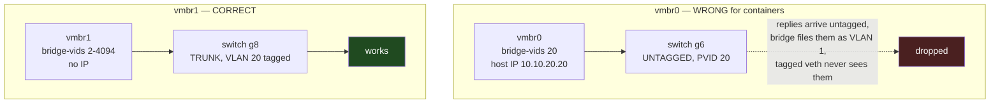

# Proxmox and Containers

Proxmox VE **9.2.20**, kernel 7.0.14-17-pve, on the X299 workstation
(i7-7740X, 24 GB, 256 GB NVMe) at `10.10.20.20`. Web UI at
https://pve.baig.network.

## Container inventory

```mermaid
graph TB
    subgraph PVE["Proxmox 10.10.20.20"]
        direction TB
        CT110["CT 110 · dns1 · 10.10.20.2<br/>AdGuard + Unbound<br/>8 GB · order 1"]
        CT111["CT 111 · proxy · 10.10.20.3<br/>nginx + wildcard cert<br/>512 MB · order 2"]
        CT112["CT 112 · db · 10.10.20.4<br/>Postgres, MariaDB, Mongo,<br/>Redis, CouchDB<br/>6 GB · order 3"]
        CT113["CT 113 · apps · 10.10.20.6<br/>yamtrack, webhook, mailcatcher,<br/>cAdvisor, exporters<br/>2 GB · order 4"]
        CT114["CT 114 · metrics · 10.10.20.5<br/>Prometheus, Loki,<br/>Alertmanager, blackbox<br/>4 GB · order 5"]
        CT115["CT 115 · grafana · 10.10.20.7<br/>Grafana 13.2.2<br/>2 GB · order 6"]
        CT116["CT 116 · vpn · 10.10.50.20<br/>WireGuard<br/>1 GB · order 7"]
        CT117["CT 117 · 10.10.50.30<br/>Docker host, private work test stack<br/>10 GB · order 8"]
        CT118["CT 118 · gitlab · 10.10.50.40<br/>GitLab CE<br/>5 GB · order 10"]
        CT119["CT 119 · registry · 10.10.50.41<br/>Docker registry<br/>1 GB · order 9"]
    end
```



All containers are **unprivileged LXC, Debian 13.6**, `onboot=1`, with an
explicit `startup order` so dns1 comes up before anything that needs to resolve.

## The bridge trap — read before creating anything

> [!CAUTION]
> **Containers go on `vmbr1`, not `vmbr0`**
> Older notes said the opposite and blamed `vmbr1` for a "container has an
> address but no internet" afternoon. **The notes had the cause backwards.**



`vmbr0` goes to an **access** port. A container there emitting `tag=20` frames
gets replies back *untagged*; the bridge files them under VLAN 1, and the
container's tagged veth never sees them. Address present, no connectivity —
exactly the symptom that was recorded, with the wrong cause attached.

Both working containers prove it:

```
CT110 dns1:  net0: ...bridge=vmbr1,firewall=1,...,tag=20
CT111 proxy: net0: ...bridge=vmbr1,firewall=1,...,tag=20
```

## Container recipe

```bash
pct create <id> local:vztmpl/debian-13-standard_13.6-1_amd64.tar.zst \
  --hostname <name> \
  --cores 2 --memory <MB> --swap <MB> \
  --rootfs local-lvm:<GB> \
  --net0 name=eth0,bridge=vmbr1,firewall=1,gw=10.10.20.1,ip=10.10.20.<x>/24,tag=20,type=veth \
  --nameserver 10.10.20.2 \
  --features nesting=1,keyctl=1 \
  --unprivileged 1 --onboot 1 --startup order=<n> --start 1
```

Notes on each part:

- **Template is `13.6-1`**, not the `13.0-1` in the old docs. Check with
  `pveam list local`.
- **No `--searchdomain`.** See the search-domain trap in [DNS](dns.md).
- **`nesting=1`** is needed for systemd 257 in an unprivileged container —
  Proxmox warns if you omit it. **`keyctl=1`** is only needed where Docker runs.
- **`firewall=1`** matches the existing containers.

Then, inside:

```bash
# IPv6 is off in this lab; stop apt trying AAAA first
echo 'Acquire::ForceIPv4 "true";' > /etc/apt/apt.conf.d/99force-ipv4
apt-get update && apt-get -y upgrade
```

## Capacity

Measured 28 Sep 2026, after VM 100 (win11) and VM 101 (ml) were destroyed:

| | Total | In use | Notes |
|---|---|---|---|
| `local-lvm` thin pool | 157 GB | ~54% | ~72 GB free — **the disk figure that matters** for guests |
| `local` (templates/ISOs) | 71 GB | ~20 GB | the Windows, virtio and Ubuntu ISOs are kept for a rebuild |
| Memory | 23.9 GB | ~9 GB | ~14.8 GB available |

> [!NOTE]
> **The old "256 GB NVMe, ~17 GB reserve" note was wrong**
> That 17 GB appears to have been the thin pool's **16.74 % used** figure read
> as gigabytes. There is plenty of room; a 32 GB rootfs is not a problem.

> [!WARNING]
> **Thin volumes do not shrink on their own**
> Files deleted inside a container stay allocated in the pool until they are
> discarded. CT 117 showed 84 % allocated against ~62 % used inside.
> `pct fstrim <id>` returns the difference.

Memory is the real constraint. Guest memory caps already add up to more than
physical RAM; that holds only while actual use stays low. See [CI and Registry](ci-and-registry.md)
for the planned additions and [Host Lifecycle](host-lifecycle.md) before adding or removing a guest.

RAM ceiling is 64 GB: the i7-7740X is Kaby Lake-X, so only 4 of the board's 8
DIMM slots work. 8 slots / 128 GB would need a 6-core-plus CPU.

## Unprivileged LXC limitations discovered the hard way

| Thing | Behaviour | Workaround |
|---|---|---|
| Raw sockets | Blocked. ICMP probes always fail, and `CAP_NET_RAW` via systemd does **not** help | Run blackbox-exporter on the Proxmox host instead |
| `net.ipv4.ping_group_range` | Cannot be set — `Invalid argument` | as above |
| `/dev/kmsg` | Does not exist. Requesting it makes a container fail to start outright | Drop the device mapping; cAdvisor runs fine without it |

## Access

SSH to `root@10.10.20.20` uses the key at `~/.ssh/id_rsa` on the Mac mini. That
key is **passphrase-protected**, so non-interactive sessions need
`ssh-add` first — otherwise everything fails with
`Permission denied (publickey,password)` even though the key is authorised.

`pct enter <id>` from the host needs no container password and is usually the
quickest way in. Containers created without `--password` have a locked root
account, so the console will reject every password — that is not a fault.
