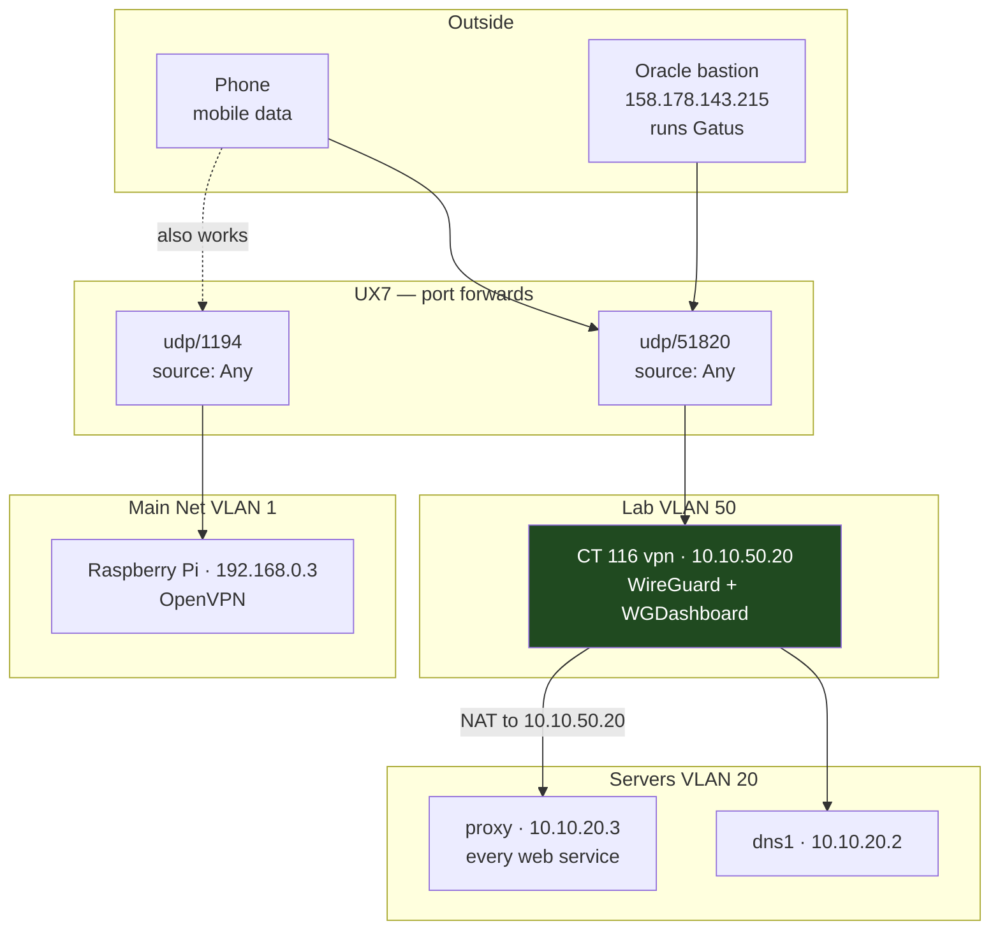

# Remote Access

Two VPNs run in parallel, on purpose. WireGuard is the modern path; OpenVPN on
the Pi is kept deliberately and is not being retired.



## WireGuard — CT 116

| | |
|---|---|
| Container | CT 116 `vpn`, **Lab VLAN 50**, `10.10.50.20` |
| Listen | udp/51820 |
| Client subnet | `10.9.0.0/24`, NATed to `10.10.50.20` |
| Endpoint clients dial | `baig.network:51820` |
| Web UI | https://wireguard.baig.network |
| Server public key | in the private secrets repo, with the peer keys |

### Why Lab and not Servers

A VPN endpoint is the most exposed thing in the lab. Lab has no standing access
to Servers, so clients get exactly what is granted rule by rule. Putting it in
Servers would have given a compromised VPN client immediate reach into the
databases.

### Why clients are NATed

Traffic leaves CT 116 as `10.10.50.20`, so the UX7 needs no static route for
`10.9.0.0/24` — one less thing to forget. The trade-off is that every VPN client
looks identical in firewall logs.

### What a VPN client can actually reach

Deliberately narrow:

| Destination | Allowed | Rule |
|---|---|---|
| `10.10.20.3` :80,443 | yes — **every web service**, they all route through the proxy | `VPN → Servers` |
| `10.10.20.2` :53 | yes — DNS, so internal names resolve | `Lab DNS` |
| Anything else in Servers | **no** | — |
| ICMP to lab hosts | **no** | — |
| Databases on `10.10.20.4` | **no** | — |

That last row is intentional. A leaked client key should not mean unrestricted
database access. Add an explicit rule if you need it, sourced from
`10.10.50.20`.

### Managing peers

**Web UI**: https://wireguard.baig.network — create, download, QR-code and watch
live handshakes. WGDashboard reads and writes `/etc/wireguard/wg0.conf` in place.

**Command line**, still works and is scriptable:

```bash
ssh root@10.10.20.20 'pct exec 116 -- /root/wg-peer.sh add <name> [full|split]'
ssh root@10.10.20.20 'pct exec 116 -- /root/wg-peer.sh list'
ssh root@10.10.20.20 'pct exec 116 -- /root/wg-peer.sh remove <name>'
```

`full` routes everything through home — you get AdGuard's 102 blocklists on
mobile data. `split` routes only the lab subnets.

Current peers:

| Peer | Address | Mode | Purpose |
|---|---|---|---|
| `phone` | `10.9.0.2` | full | mobile |
| `oracle` | `10.9.0.3` | split | Gatus, external monitoring |

> [!WARNING]
> **Two bugs worth knowing about**
> **`wg-peer.sh` handed every peer `10.9.0.2`.** Its address allocator grepped
> for `AllowedIPs = ` with a single space, but the config writer emits padding,
> so the match always failed and the counter never advanced. Fixed — but if you
> ever see two peers with the same address, this is why.
>
> **WGDashboard's gunicorn daemonises itself.** The unit must be
> `Type=forking` with a `PIDFile`; under `Type=simple` systemd reports the
> service active once, then immediately dead, with nothing listening.

## OpenVPN — the Raspberry Pi

Kept. Not being retired.

| | |
|---|---|
| Host | `192.168.0.3`, Main Net |
| Unit | `openvpn@server.service` — reads `/etc/openvpn/server.conf` |
| Listen | udp/1194 |
| Client subnet | `10.8.0.0/24` |
| Pushed DNS | `10.10.20.2` |

> [!CAUTION]
> **Debian ships two OpenVPN layouts and both were enabled**
> `openvpn@server.service` reads `/etc/openvpn/*.conf` and is the one that
> works. `openvpn-server@server.service` reads `/etc/openvpn/server/*.conf` and
> was crash-looping forever, unable to bind udp/1194 because the working unit
> already held it.
>
> That crash-loop is what "OpenVPN died" looked like. It had not died. Check
> which unit you are looking at before concluding anything:
>
> ```bash
> systemctl list-units --all 'openvpn*'
> ```
>
> `openvpn-server@server` is now disabled, along with `openvpn.service` and
> `openvpn@server_backup`.

The pushed DNS used to be `10.8.0.1` — the Pi's own tun address, where a local
unbound listened. That unbound is dead and disabled, so clients were being
handed a resolver that does not exist. Now they get dns1.

## Why the VPN ports accept any source

Both forwards are `Source: Any`, and that is correct.

OpenVPN here uses **`tls-crypt`**, which wraps the entire TLS handshake in a
pre-shared symmetric key. A packet without that key is discarded before any
negotiation — no reply, no banner, no version string. To a scanner the port
looks closed. WireGuard behaves the same way by design.

A source allowlist on a VPN port is not defence in depth; it is an availability
constraint that blocks you the moment you are on a new network. The real
exposure is *inside* the tunnel, which is why `VPN → Servers` is narrow.

What an allowlist would still buy: slightly earlier drop of UDP floods, and
limiting where a leaked key can be used from. Neither outweighs not being able
to connect from a hotel.

## Certificates and the changing WAN address

Clients dial `baig.network:51820`, not an IP. The apex A record is kept current
by `/root/cf-ddns.py` on CT 111, running every 10 minutes:

- DNS-only, never proxied — a proxied record would route through Cloudflare's
  edge and break the source rules on the UX7, and would not cover UDP at all
- Re-asserts DNS-only and TTL 120 on every run, so a stray orange cloud in the
  Cloudflare UI gets corrected automatically
- Refuses to publish anything if its two IP sources disagree

See [Reverse Proxy and Certificates](reverse-proxy-and-certificates.md) for the certificate itself.

## The Oracle bastion

Sits outside the network at `158.178.143.215`, runs **Gatus**, and reaches in
over WireGuard as peer `oracle` (`10.9.0.3`, split tunnel).

It moved off OpenVPN on 27 Sep 2026. Two things improved:

1. Its DNS used to be `192.168.0.3` — the Pi — with Pi-hole as the resolver.
   That resolver is gone. It now uses dns1 for `baig.network` only, scoped via
   `resolvectl domain wg0 ~baig.network`, so a tunnel drop cannot break apt,
   Docker pulls or Gatus's external checks.
2. OpenVPN pushed `redirect-gateway def1`, which routed **all** of Oracle's
   internet traffic through the house and back out through Leaptel. Its
   internet path is now direct.

See [External Monitoring](external-monitoring.md) for what Gatus actually watches.
