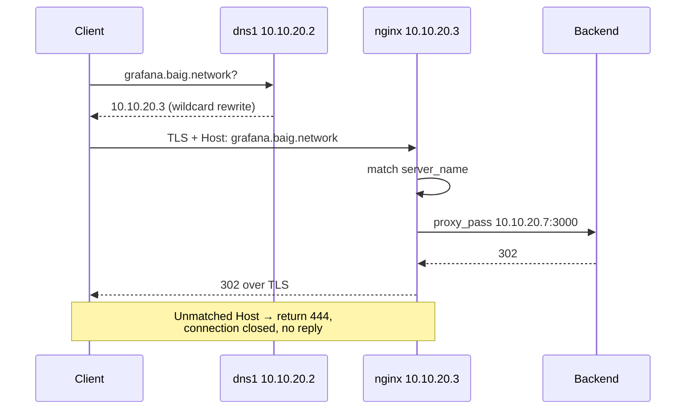
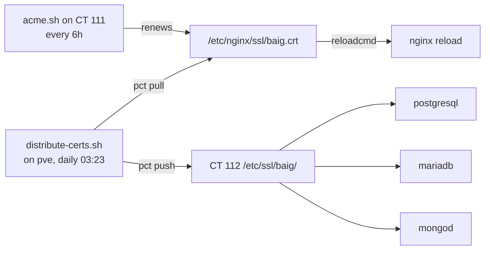

# Reverse Proxy and Certificates

`proxy.servers.baig.network` → `10.10.20.3` (CT 111). One nginx config at
`/etc/nginx/conf.d/baig.conf`, one certificate at `/etc/nginx/ssl/baig.crt`
and `.key`.

## How a request flows



**Moving a service is one `proxy_pass` line.** That is the entire point of the
flat naming scheme — no DNS change is needed, because every flat name already
resolves to the proxy via the `*.baig.network` rewrite.

## Deploying a config change

```bash
scp baig.conf root@10.10.20.20:/root/baig.conf
ssh root@10.10.20.20 'pct push 111 /root/baig.conf /etc/nginx/conf.d/baig.conf \
  && pct exec 111 -- nginx -t \
  && pct exec 111 -- systemctl reload nginx'
```

`nginx -t` before reload, always. A bad config that reloads is a lab-wide
outage.

## Blocks that differ from the standard pattern

| Name | Difference | Why |
|---|---|---|
| `pve` | `proxy_read_timeout 3600s`, `proxy_buffering off` | web console and shell would drop otherwise |
| `router` | `proxy_ssl_verify off`, `proxy_ssl_server_name on`, 3600s read timeout, buffering off | see below |
| `netgear` | plain-HTTP upstream to `192.168.0.119`, buffering off | switch has no TLS; see below |
| `oracle` | plain-HTTP upstream across the internet | Oracle has no TLS listener |
| `obsidian` | `client_max_body_size 4g`, `proxy_read_timeout 3600s`, buffering off | LiveSync holds a continuous `_changes` feed open; nginx's 1 MB default body limit breaks large notes silently |
| work dev-stack APIs | per-location routing to the MacBook, a few injected headers | |
| `_` (catch-all) | `return 444` | |

### Proxying a backend that has a self-signed certificate

Two backends present certificates nothing trusts — Proxmox signs with its own CA,
and the UniFi gateway presents `CN=unifi.local` issued to itself. Both are proxied
precisely *because* of that: the browser gets the real wildcard certificate for
`pve.baig.network` / `router.baig.network`, instead of a warning you learn to click
through and would then miss on a day it mattered.

```nginx
proxy_pass https://10.10.20.1;      # the gateway's Servers-VLAN interface
proxy_ssl_verify off;               # accepts CN=unifi.local
proxy_ssl_server_name on;           # still sends SNI
```

`oracle` is the one upstream that is **not** on the LAN. It goes to
`http://158.178.143.215:80` across the internet, because Oracle has no TLS listener
(`:443` is closed) and there is no route from the proxy into the WireGuard tunnel —
`ip route get 10.9.0.3` leaves via the default gateway, and Oracle's firewall blocks
`wg0` inbound regardless. So browser→nginx is encrypted and nginx→Oracle is not.

That is no worse than the arrangement it replaced, where the browser went direct
over `http://`, and it fixes a real problem: an `http://` fetch from an `https://`
page is mixed content, which is why that card on the service register had to carry
`data-nocheck` and could never show a status. Closing the remaining gap needs either
a certificate on Oracle or the tunnel opened the other way.

> [!CAUTION]
> **This puts the watchdog behind the thing it watches**
> Gatus answers *"is the lab reachable from outside?"*. Reached through this proxy,
> the moment the lab is down is the moment the dashboard is too. Telegram alerting
> is unaffected, and **`http://158.178.143.215/` still works directly** — that is
> the address to use when the house is on fire, and it stays in the register card's
> subtitle for exactly that reason.

`proxy_ssl_verify off` means nginx does not verify the **backend's** certificate.
It does not weaken the client-facing side, which stays fully verified — `curl`
without `-k` succeeds. It is acceptable here only because that hop never leaves
the Servers VLAN; on an untrusted path it would need `proxy_ssl_trusted_certificate`
instead.

`router` points at **`10.10.20.1`**, not `192.168.0.1`. Both addresses answer, but
`.1` on this subnet is one hop from the proxy and needs no inter-VLAN policy to
keep working.

UniFi OS is a single-page app with long-lived websockets for live stats, so it
needs the `Upgrade` headers, `proxy_buffering off`, and a read timeout well past
nginx's 60s default — otherwise the UI silently drops its connection every minute.

> [!NOTE]
> **UniFi OS accepts a rewritten `Host` header**
> Some appliance UIs reject a `Host` they do not recognise as a CSRF measure,
> which forces `proxy_set_header Host $proxy_host`. This one does not — it serves
> normally with `Host: router.baig.network`, so the standard pattern applies.

> [!NOTE]
> **`https://baig.network/` is deliberately NOT redirected — deferred 27 Sep 2026**
> The apex has its own server block and it is correct, but nothing reaches it from
> inside: internal DNS returns the **public WAN address** for the bare apex,
> because the `*.baig.network` rewrite matches one label and not zero. With no 443
> forward, the request hangs.
>
> Making it work needs an exact AdGuard rewrite `baig.network` → `10.10.20.3`. That
> conflicts with WireGuard, because **every peer has
> `Endpoint = baig.network:51820`** — the apex is doing two jobs, web entry point
> and VPN endpoint, and an internal rewrite serves the first by breaking the second.
>
> Blast radius, measured rather than assumed:
>
> | Case | Effect of the rewrite |
> |---|---|
> | Starting a tunnel **while on home Wi-Fi** | **breaks** — resolves `10.10.20.3:51820`, nothing listens |
> | Connecting from cellular or outside | fine, uses public DNS |
> | Oracle | fine — when `wg0` is down its `~baig.network` scope disappears and it falls back to `9.9.9.9` |
> | Already-connected tunnels | fine, the endpoint is resolved once at bring-up |
>
> The clean fix is to stop the apex doing two jobs: give the VPN its own name
> (`vpn.baig.network` → WAN, DNS-only in Cloudflare), repoint the peers, then the
> apex is free. That means re-importing the config on four devices, and a device
> that is missed cannot reconnect from home Wi-Fi.
>
> **Deferred on purpose.** The benefit is typing nine fewer characters; the cost is
> churn across the VPN on the same day the lab was rebuilt. The oddball-name
> redirect above already catches every mistyped and retired service name, which was
> the actual problem worth solving.

### The GS724T switch, and why an http:// name stopped working

`netgear.main.baig.network` resolved correctly — `dig` returned `192.168.0.119`
every time — and could be reached by IP, yet the name failed in a browser. Nothing
to do with DNS: modern browsers upgrade a **typed hostname** to `https://`, the
switch has no TLS (`:443` closed), and the upgrade fails. A raw IP is not treated
the same way, which is exactly why "works by IP, not by name" looked like a DNS
fault and was not.

Fixed the same way as the router: the AdGuard rewrite was removed so the name falls
to the `*.baig.network` wildcard and lands here, and nginx proxies
`http://192.168.0.119:80`. The wildcard certificate already covers
`*.main.baig.network`, so no new SAN was needed and the name did not have to change.

The UI is an old frame-based one, but every reference is root-relative
(`/base/style.css`, `/base/js/...`) with no absolute URLs, and it accepts a
rewritten `Host` — verified before switching — so it proxies with no path rewriting.

The plain-HTTP hop is permitted by the `Servers → Main Net mgmt` policy (22/80/443
to `.3`, `.91`, `.119` only). A 502 here means that policy, not the switch.

## The catch-all, and where oddball names go

Behaviour depends on **source address**, via a `geo` block:

| Source | Unknown hostname | Why |
|---|---|---|
| Lab VLANs, VPN, Main Net | **302** to `https://home.baig.network/` | a wrong name here is a typo; a dead connection is a poor way to learn that |
| Anything else | **444** — close, no reply | tells a scanner nothing |

```nginx
geo $lab_client {
    default        0;
    10.10.0.0/16   1;   # every VLAN, including 10.10.50.20 (VPN egress)
    10.9.0.0/24    1;   # WireGuard peers directly, if masquerade is dropped
    192.168.0.0/25 1;
    127.0.0.0/8    1;
}
```

> [!IMPORTANT]
> **`10.10.50.20`, not `10.9.0.0/24`, is what makes the VPN work**
> CT 116 MASQUERADEs `10.9.0.0/24` out of `eth0`, so nginx sees the **VPN
> container**, never the peer address — the access log shows thousands of
> requests from `10.10.50.20` and none from `10.9.0.x`. A `geo` block keyed only
> on the peer subnet would match nothing and silently 444 every VPN client.

`tcp/443` is **not** forwarded on the UX7 — verified from the Oracle box straight
at the WAN address, both 80 and 443 filtered — so nothing outside can reach this
today. It is written by source anyway so it stays correct the day a forward is
added and nobody remembers this file.

The redirect drops the path. The register is one page, so `/some/deep/path`
carried onto it would only 404.

Port 80 keeps its own catch-all, `301 https://$host$request_uri`. It preserves the
hostname, so an `http://` oddball takes two hops: to HTTPS, then to the register.

> [!WARNING]
> **Only names the certificate covers can be redirected**
> The SAN list is `*.baig.network` plus `*.<vlan>.baig.network` — **one** extra
> label. `a.b.baig.network` fails TLS verification before nginx sees the request,
> so no redirect is possible. AdGuard's `*.baig.network` rewrite resolves those to
> the proxy quite happily, which makes it look like a proxy fault. It is not; it
> needs another SAN.

> [!CAUTION]
> **This makes typos land somewhere instead of failing**
> A mistyped or deleted vhost now quietly shows the register rather than erroring.
> That is the point, but it also means a genuinely missing service looks like a
> typo. Check the register's card list, or `nginx -T | grep server_name`.

## The catch-all

Previously `home.baig.network` was `default_server` with `autoindex on`, so any
unmatched hostname produced a directory listing of `/var/www/hosts`. That is
fixed: `home` is now a normal named block serving the service register, and a
separate `server_name _` block returns **444** — connection closed with no
response, which tells a scanner nothing.

Verify with:

```bash
curl -o /dev/null -w '%{http_code}\n' --max-time 8 \
  --resolve nonexistent.baig.network:443:10.10.20.3 \
  https://nonexistent.baig.network/
# expect 000 — curl reporting an empty reply, which is what 444 produces
```

## Certificate

One certificate covering **every** domain level:

```
baig.network
*.baig.network
*.servers.baig.network
*.home.baig.network
*.lab.baig.network
*.iot.baig.network
*.main.baig.network
```

A wildcard covers exactly one label, which is why the per-VLAN levels each need
their own entry — `*.baig.network` does **not** match
`db.servers.baig.network`.

Issued by Let's Encrypt via DNS-01 against Cloudflare, so nothing needs to be
publicly reachable:

```bash
acme.sh --issue --dns dns_cf \
  -d baig.network -d '*.baig.network' \
  -d '*.servers.baig.network' -d '*.home.baig.network' \
  -d '*.lab.baig.network'     -d '*.iot.baig.network' \
  -d '*.main.baig.network'

acme.sh --install-cert -d baig.network --ecc \
  --key-file       /etc/nginx/ssl/baig.key \
  --fullchain-file /etc/nginx/ssl/baig.crt \
  --reloadcmd      "systemctl reload nginx"
```

`CF_Token` must be a scoped token with **Zone:DNS:Edit on this zone only**.
It lives in `/root/.acme.sh/account.conf` on CT 111.

Renewal runs from cron on CT 111 every six hours (`12 1,7,13,19 * * *`).
acme.sh picks its renewal date from the ARI window the CA advertises.

## Distribution

nginx is not the only thing that serves this certificate — the database engines
on CT 112 do too. acme.sh only knows how to reload nginx, so without help the
databases would keep serving an expired certificate for months.



`/root/distribute-certs.sh` on the Proxmox host compares SHA-256 fingerprints
and does nothing when they already match, so it is safe to run any time.

## Monitoring

Expiry is not watched by a dedicated service. Every HTTPS blackbox probe
already reports `probe_ssl_earliest_cert_expiry`, so the watch is a Prometheus
rule over data being collected anyway — see [Monitoring](monitoring.md). Alerts fire at 21
days (warning) and 7 days (critical).

> [!NOTE]
> **This nearly mattered**
> Renewal needs `api.cloudflare.com` and `acme-v02.api.letsencrypt.org` to
> resolve. Both were unresolvable during the DNS interception period, and
> nothing would have reported the failed renewal until the certificate expired.
> See [DNS](dns.md).

## What is not covered

- **The GS724T switch** at `netgear.main.baig.network` is HTTP only. It serves
  its own web UI; there is no way to install a certificate on it, and there
  should not be.
- **Database wire protocols** present the certificate but do not require it.
